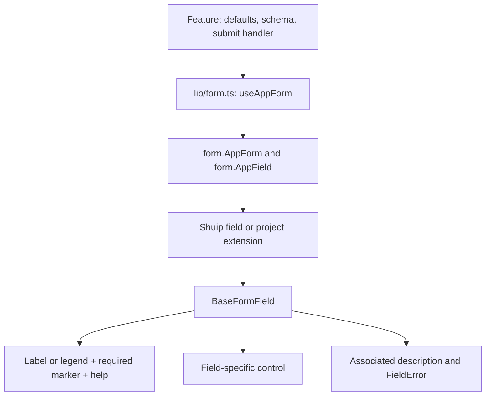

# Architecture Context

## Stack

| Layer     | Technology                   | Role   |
| --------- | ---------------------------- | ------ |
| Framework | [e.g. Vite + TypeScript]     | [Role] |
| UI        | [e.g. Tailwind + shadcn/ui]  | [Role] |
| Auth      | [e.g. supabase auth]         | [Role] |
| Database  | [e.g. supabase + PostgreSQL] | [Role] |

## System Boundaries

### Refine resources and business commands (agreed standard)

Refine owns resource CRUD, table query state and the resource cache, backed by TanStack Query. Business commands use feature-owned TanStack Query `useMutation` hooks that call Supabase RPC through the shared authenticated client, then refresh affected Refine queries with `useInvalidate`.

The [resource migration plan](./resource-migration-plan.md) specifies proposed views, filters, search, sorting, pagination, forms and delivery phases for the legacy admin. Its [route inventory](./legacy-admin-route-inventory.md) maps all 88 source page routes and the 58 navigation tabs/permissions. These documents are a plan and source audit, not evidence that the resources or RPCs are implemented or deployed.

| Operation                                           | Owner                                                                      | Supabase access                                           |
| --------------------------------------------------- | -------------------------------------------------------------------------- | --------------------------------------------------------- |
| List/detail reads                                   | Refine `useTable`, `useList`, `useOne`                                     | Existing Supabase data provider                           |
| Create/update/delete a resource                     | Shared CRUD hooks under `src/hooks/resources/`, using Refine mutations      | Selected Refine data provider                            |
| Confirm/cancel an order or another business command | Feature hook using TanStack Query `useMutation`                            | Named database function through `supabaseClient.rpc(...)` |
| Column sorting, filters and pagination              | Refine table state                                                         | Provider applies these to the database query              |
| Persist a manually reordered sequence               | Feature command mutation                                                   | RPC saves the permitted sequence atomically               |

#### CRUD resources and tables

- Register resources in the existing resource registry and reuse `ResourceProvider` and resource dialogs. Keep list/table state, detail reads, CRUD mutations, submission guards and cache invalidation in `src/hooks/resources/`; keep presentation in `components/resources/`. Feature fields, schemas, defaults and allowlisted payload mapping stay in the feature.
- Ordinary field edits use Refine CRUD mutations. Business operations with transition rules or coordinated writes use an explicit command such as `confirm_order`; the UI does not implement those operations as an unrestricted status update.
- Configure sorting with `refineCoreProps.sorters` / Refine `setSorters`, and let the Supabase provider apply it before pagination. Use a stable secondary key such as `id` when primary sort values can tie. Display sorting does not write a stored sequence.
- Keep reads in Refine so tables, details, counts and selectors share its query keys. Do not introduce parallel feature query caches for the same resource data.

#### Command flow and cache ownership

1. A row/menu/dialog action calls a feature hook such as `useConfirmOrder`. The component supplies explicit command inputs and renders pending/error/success states; it does not own database rules.
2. The hook uses `useMutation` from `@tanstack/react-query` and calls a feature command function using the existing shared Supabase client. Pass typed, validated arguments to `supabaseClient.rpc("confirm_order", { p_order_id: orderId })`; throw returned Supabase errors so the mutation enters its error state.
3. The database function enforces authorization and allowed transitions, and performs related database writes in one transaction. RLS and appropriate function permissions remain authoritative. Prefer security-invoker functions; any privileged execution requires explicit authorization checks. An RPC name in this document is illustrative, not an existing database contract.
4. After success, use Refine `useInvalidate` for the affected resource list/detail queries, the affected record ID and any related counts or resources changed by the command. Specify `dataProviderName` when the resource uses a named provider. Invalidation must target the same Refine context/provider that owns the reads.
5. Use the QueryClient backing that Refine context. Do not mount a separate QueryClient/cache for commands or manually reproduce Refine query keys. Guard duplicate submissions and disable automatic retries (`retry: false`) unless the command is explicitly designed for safe retries. A mutation pending state alone does not provide server-side idempotency.

Commands belong in their feature, for example `features/orders/commands.ts` for RPC calls and `features/orders/use-confirm-order.ts` for mutation state and invalidation. Reuse schemas from `src/lib/schema/` where applicable. Generic resource components supply action handlers and remain unaware of order-specific RPCs. Commands involving external services may use a server/Edge Function boundary; database rules and atomic database writes still belong on the server.

#### Saved row ordering

- Existing row dragging remains UI-only and limited to the loaded page. `onReorder(ids, rows)` is an extension point, not an automatic persistence contract.
- When a feature explicitly requires saved ordering, define its sequence field (for example the catalog's `sort_order`), scope and pagination/filter behavior first. A feature mutation calls an RPC that validates the rows and permissions and writes the sequence atomically, then invalidates the Refine list. Do not assume the currently loaded page is the complete sequence.

#### Adoption status

This is the standard for new business commands. Current CRUD/resource table behavior already follows the Refine path. Notification mark-all-read still uses the existing Refine `useCustomMutation` adapter described below; it has not been migrated by this documentation change. Before implementing a direct TanStack mutation, declare `@tanstack/react-query` as a direct admin dependency at a version compatible with Refine's installed QueryClient. No order RPC, persisted reordering, dependency change or runtime migration is introduced here.

### Application error handling

- `AppErrorBoundary` in `components/route-states/` wraps the full application in `main.tsx`, outside Suspense, development tools, theme/direction/tooltip providers, router and toaster. Render/lifecycle failures outside route boundaries reuse the shadcn `RootError` screen with retry (remount children) and full reload actions. It has no dependency on Refine, router or theme context and supplies RTL explicitly.
- TanStack Router continues to use `RootError` for route failures. User-facing error copy is generic; raw details appear only in development. Error boundaries do not catch Vite import/compilation failures, event-handler exceptions or arbitrary rejected promises; request/form handlers retain their existing error states. Restart the dev server after branch switches that remove/recreate Vite config or imported modules if its resolver retains stale failures.

### Shared admin session and identity

- `routes/__root.tsx` owns the TanStack route guard and Supabase auth-change
  invalidation. The Refine boundary is composed in `providers/refine/provider.tsx`
  and exported as `RefineProvider`; the root route no longer contains Refine's
  resource/provider registry.
- `providers/refine/provider.tsx` composes the Refine configuration. Auth, i18n,
  notifications, router and resources each have a sibling file in
  `providers/refine/`. The named data-provider registry and all of its adapters
  live together in `providers/refine/data-provider/`; feature screens import a
  feature action from that folder only when their UI flow needs it.
- The named adapter map uses `default` and `siteSettings` for the shared RLS
  Supabase adapter in `data-provider/supabase-data-provider.ts`, plus
  `notifications`, `mediaLibrary`, `account` and `users` for their scoped
  adapters. The users adapter invokes the protected
  `admin-users` Edge Function; list filters, sorting and pagination are sent to
  the server through `data-provider/users-query.ts`.

The route-to-provider flow and current module layout are documented in
[`doc/application-architecture.md`](../doc/application-architecture.md).

### Shared admin layout

- The root route owns the single `AdminLayout` instance for authenticated admin
  pages. Feature route-group files render only their nested `Outlet`, so pages
  do not wrap themselves in the sidebar/header shell.
- `/sign-in`, OAuth callback/link routes and `/reset-password` stay outside the
  admin shell so auth screens remain full-screen. The shell reads the current
  TanStack Router pathname to display the matching Arabic breadcrumb label.

- `createAdminAuthProvider` shares one verified user/profile read between route `check` and `getIdentity`. Successful eligible-admin results stay in browser memory for 60 seconds; simultaneous calls share one promise. Missing users, rejected roles, archived profiles and failed reads are not cached as successful sessions. New reads still use Supabase `getUser` and the existing profile query.
- Login/logout and Supabase session-token/account changes or `USER_UPDATED` invalidate the cache. A version prevents older in-flight requests from repopulating it after invalidation. The Supabase listener is synchronous, registered before route guards, and unsubscribed during hot reload. Repeated same-session `SIGNED_IN` events do not invalidate the cache.
- Root `AdminIdentityProvider` owns the only UI `useGetIdentity` call, above all nested Refine contexts. Layout, notifications and user components consume `useAdminIdentity`; showcase providers cannot create a second identity read. Its versioned Refine key drops previous-session results, disables sign-in/OAuth reads, uses 60-second freshness, and disables window-focus refetch. Old unused identity keys are immediately collected.
- Route guards still reject unavailable/unauthorized sessions and revalidate when the shared cache expires. Account switches, logout and user updates re-run the router guard. The short cache is for browser navigation/display only; existing database RLS and server authorization remain authoritative for data access and mutations. No persistent identity cache or database change is introduced.

### Site branding and home navigation

- `features/site-branding/SiteBrandingProvider` (implemented in `provider.tsx`) mounts inside root Refine above the route outlet. It reads only site name/logo/favicon from `site_settings` / `general` using the root named `siteSettings` provider and the shared authenticated Supabase client. The existing route guard permits the read only on protected pages; sign-in and OAuth callback disable it. It starts alongside layout identity loading, without waiting for `useGetIdentity`, and never blocks page rendering.
- Root Refine owns the in-memory cache: five-minute freshness, thirty-minute retention, no polling or window-focus refetch. Branding context crosses nested showcase Refine boundaries, so showcase does not register or query its own branding provider. Demo default providers remain local. Full page refresh reloads branding; no localStorage or static asset export is used.
- `SiteBranding` renders only the logo in the expanded sidebar (including the mobile drawer) and only the favicon in the collapsed sidebar. Fixed-size shadcn Skeletons cover initial metadata/image loading; background data refresh retains the previous result. Empty/failed images fall back to the site name/book icon. A scoped effect synchronizes the browser favicon and removes its own link on unmount/change. Only HTTP/HTTPS image URLs are accepted. No configuration writes are made.
- The header uses shadcn Breadcrumb with TanStack Router's Link for `/`, including on showcase pages where the demo Refine Link intentionally suppresses navigation. `/` remains the existing redirect to `/theme`; the auth router's allowlist accepts `/` too.

### Header notifications (implemented)

- `features/notifications/use-header-notifications.ts` owns the current-user read model through Refine `useGetIdentity` and two `useList` queries. Both filter `recipient_profile_id` explicitly; the recipient is included in Refine's cache keys. Queries stay disabled without an identity and do not use previous-recipient placeholder data.
- The central Refine registry and any nested showcase context expose `notificationsDataProvider` under the named `notifications` provider; it delegates normal reads to the existing shared Supabase data provider. Notification hooks always specify the named provider and never depend on another context's default.
- Latest 20 rows and exact unread total are separate reads. Both poll every 10 seconds while the header is mounted in a visible tab, even if the popover is closed. Polling pauses in hidden tabs and ends on unmount. Failed refreshes retain successful cached data, expose a visible error and allow manual retry; an unknown unread total is not displayed as zero.
- `NotificationsPopover` is mounted once in `AdminLayout` for desktop/mobile, uses shadcn Popover and semantic tokens, and formats timestamps in `ar-EG` / `Africa/Cairo`. It renders plain notification text and a local link to `/notifications`; stored notification links remain inactive. Shared `NotificationItem` uses semantic primary colors for unread items and muted colors for read items, with explicit status labels. `/notifications` lists all current-user notices with 20-row pagination and the same read/error/polling behavior.
- `MarkAllReadButton` invokes Refine `useCustomMutation` through the named provider using the logical command `notifications/mark-all-read`. The adapter verifies the shared client session with `auth.getUser`, rejects a changed expected identity, and updates only `is_read` on that verified user’s unread rows in one database statement. It does not enumerate IDs, so pagination and the 1,000-row response limit do not restrict the update. Submission is guarded while pending, mutations do not automatically retry, and failures stay visible. Success invalidates notification list queries (including the count). Existing RLS remains authoritative; no schema changes, sends, deletes or Realtime subscriptions were introduced.

### Validation schemas (implemented)

- `src/lib/schema/` is the shared validation layer for auth and legacy admin feature families. Only auth, platform products and add-ons currently consume it in live admin UI. It exports Zod schemas, inferred input/output types and separate form/action/read registries through `index.ts`; it does not import feature code or execute requests.
- Existing client product/add-on input rules were reviewed as reference. Admin form values preserve numeric strings; feature models own defaults, row adapters and allowlisted database payload mapping. Schema extraction preserves existing admin validation behavior. See `src/lib/schema/README.md` for scope and source differences.

### Form field presentation architecture

All admin forms use the shared Shuip/TanStack field system. A feature chooses the field, label, description and validation rules; the shared field components present them consistently in pages, dialogs and sheets.

#### Ownership and composition



| Layer                  | Location                                                                        | Responsibility                                                                                                       |
| ---------------------- | ------------------------------------------------------------------------------- | -------------------------------------------------------------------------------------------------------------------- |
| Feature form           | `features/<feature>/`                                                           | Defaults, schema, field selection, copy, option loading, pending state and submit/payload mapping                    |
| Form factory           | [`src/lib/form.ts`](../src/lib/form.ts)                                         | Single `createFormHook` registration; exports `useAppForm`, `withForm`, `withFieldGroup`                             |
| Shared context         | [`form-context.tsx`](../src/components/ui/shuip/tanstack-form/form-context.tsx) | Single `fieldContext` / `formContext` pair used by every field and form action                                       |
| Field adapter          | [`ui/shuip/tanstack-form/`](../src/components/ui/shuip/tanstack-form/)          | Reads `useFieldContext<T>()`; binds value, change and blur; supplies control IDs, disabled state and ARIA attributes |
| Field presentation     | [`base-form-field.tsx`](../src/components/forms/components/base-form-field.tsx) | Label/legend, required marker, description help, normalized errors and vertical/horizontal layout                    |
| Description help       | [`field-help.tsx`](../src/components/forms/components/field-help.tsx)           | Shared `FormFieldHelp`, also exported as `DescriptionBadge` and `FieldHelp`                                          |
| Primitives and layouts | `components/ui/`, `components/forms/layouts/`                                   | shadcn controls, FieldGroup, dialogs, sheets and sections                                                            |

Keep value binding in the adapter and validation/business rules in the feature. BaseFormField handles presentation and reads field metadata when available; it does not create form state, perform requests or save records. Refine continues to own resource mutations and their cache as described above.

#### Visual contract

The default field presents a label row, the control, then an error when invalid. The label row contains the label, an optional required `*`, and optional description help. Hidden description text remains associated with the control independently of whether the tooltip is open.

| Presentation      | Convention                                                                                                                                                         |
| ----------------- | ------------------------------------------------------------------------------------------------------------------------------------------------------------------ |
| Label             | Clear feature-owned Arabic text; ordinary controls use `FieldLabel` with `htmlFor` matching the control ID                                                         |
| Required          | Set the field's top-level `required` prop for the marker and supported control semantics; enforce required values in the schema too                                |
| Description       | Pass `description` for field-level help. The agreed design is a small help Badge/icon beside the label with tooltip content; omit it when the description is empty |
| Error             | Render below the control using shadcn `FieldError`; strings and Zod issues are normalized by [`form-errors.ts`](../src/lib/form-errors.ts)                         |
| Invalid state     | `data-invalid` on the field wrapper and `aria-invalid` on the control, with an error ID in `aria-describedby`                                                      |
| Disabled state    | Wrapper `data-disabled` plus actual control `disabled`; a visual wrapper alone does not prevent editing                                                            |
| Checkbox          | Horizontal composition, control first and label/help alongside it                                                                                                  |
| Radio/time groups | `variant="fieldset"`, `FieldSet` and `FieldLegend`, with individual option/subcontrol names                                                                        |
| Unlabeled control | Supply an accessible name; BaseFormField render props expose `aria-label`. Help can render separately when no visible label exists                                 |
| Direction         | Inherit RTL, use logical spacing and start-aligned errors. Set LTR on values that need it, such as email, URLs and time parts                                      |

Description help is supplementary: keep instructions needed to complete a task visibly available in the surrounding form. The shared help trigger must be keyboard focusable, have an accessible name and use `type="button"` so opening help cannot submit a form. Field descriptions use `description`; the optional Shuip `tooltip` prop is a separate control-addon affordance and should not duplicate that description.

**Current implementation gap:** `field-help.tsx` currently places an `aria-hidden` icon directly inside `TooltipTrigger asChild`; it does not render the Badge/button or use its `label` for an accessible trigger name. The Badge/button and keyboard-access requirements above describe the agreed presentation contract and still need to be restored in that helper. This documentation update does not change runtime components.

#### Field APIs and value shapes

Use the actual registered Shuip component names. Native input/selection attributes belong in `props`; date fields expose their own `disabled`, `locale`, bounds and, where supported, `triggerProps`. `fieldProps` configures the outer Field; it does not bind or disable the child control. Check each field's exported interface rather than assuming all fields accept identical props. BaseFormField itself accepts React-node labels/descriptions; most installed Shuip adapters currently accept strings.

| Field                                          | Value and use                                                                                                                                                                                                           |
| ---------------------------------------------- | ----------------------------------------------------------------------------------------------------------------------------------------------------------------------------------------------------------------------- |
| `InputField`, `TextareaField`, `PasswordField` | Text. Numeric InputField uses numeric defaults and `props.type="number"`; an emptied numeric input can produce NaN, so validate it                                                                                      |
| `AutocompleteField`                            | Text with static suggestions or asynchronous search; users may enter text outside the suggestions                                                                                                                       |
| `SelectField`                                  | One stored string; options map display labels to stored values, for example `{ "نشط": "active" }`                                                                                                                       |
| `ComboboxField`                                | Stored string, or string array with `multiple`; options are `{ label, value }` records; supports asynchronous search                                                                                                    |
| `CheckboxField`, `RadioField`                  | Boolean, or one option's string value respectively                                                                                                                                                                      |
| `DateField`, `DatetimeField`, `MonthField`     | `Date \| undefined`; MonthField normalizes the selection to the first day of the month                                                                                                                                  |
| `DateRangeField`                               | `{ from, to? } \| undefined`, with date values and possibly an unfinished selection                                                                                                                                     |
| `TimeField`, `TimeRangeField`                  | HH:mm string, or `{ start, end }`; the feature schema owns required/range rules                                                                                                                                         |
| `InlineEditField`                              | String; commits validate and invoke the owning form's submit handler. Use a dedicated form when saving should affect only that value                                                                                    |
| `ImageUploadField`, `AttachmentsField`         | Project extensions: completed `CloudinaryUploadResult \| string \| null` and local `File[]` respectively; ImageUploadField uses UploadCN when supplied a signed adapter, while AttachmentsField remains local selection |

Catalog price and sort-order forms intentionally keep numeric strings using `inputMode`. Feature code converts values into allowlisted API payloads, including explicit date/time serialization where needed. A Date object in form state does not define the database's date or timezone contract.

#### Standard feature form

```tsx
import { useAppForm } from "@/lib/form";
import { FieldGroup } from "@/components/ui/field";

const form = useAppForm({
  defaultValues,
  validators: { onChange: schema, onSubmit: schema },
  onSubmit: async ({ value }) => onSave(toPayload(value)),
});

return (
  <form.AppForm>
    <form
      id={formId}
      noValidate
      onSubmit={(event) => {
        event.preventDefault();
        event.stopPropagation();
        if (!saving) void form.handleSubmit();
      }}
    >
      <FieldGroup>
        <form.AppField name="name">
          {(field) => (
            <field.InputField
              label="الاسم"
              description="الاسم الذي يظهر في الكتالوج."
              required
              props={{ disabled: saving }}
            />
          )}
        </form.AppField>
      </FieldGroup>
      <form.FormErrorSummary />
      <form.FormActions>
        <form.SubmitButton props={{ disabled: saving }}>حفظ</form.SubmitButton>
      </form.FormActions>
    </form>
  </form.AppForm>
);
```

`defaultValues`, `schema`, `onSave`, `toPayload`, `formId` and `saving` are supplied by the feature. For a dialog footer outside the native form, keep it under `form.AppForm` and pass `props={{ form: formId, disabled: saving }}` to SubmitButton. SubmitButton combines caller-disabled state with TanStack's `isSubmitting` / `canSubmit`. Mutation failures remain visible through the owning feature; `FormErrorSummary` supplies generic form-validation feedback.

For a new control, first choose an installed Shuip field. If a project-specific adapter is necessary, read the existing shared `useFieldContext<T>()`, render BaseFormField once, bind value/change/blur and register it in `src/lib/form.ts`. Use BaseFormField's render-function children to obtain generated IDs, required/disabled values and ARIA associations; spread them onto compatible controls or map them to the control's API. For ordinary children, supply `htmlFor` and wire matching control attributes explicitly. Custom controls without a labelable HTML element use `labelTarget="labelledBy"` and must apply the supplied `aria-labelledby` themselves.

#### Adoption and verification

All 15 Shuip field types, shared context and SubmitButton are installed from `@shuip`; registry code is owned locally and composed with the existing Radix/shadcn primitives. Catalog create/edit, sign-in, Refine/overlay demos and image-upload demo use the shared factory. The image demo requires an explicitly configured Cloudinary adapter before uploading. `/fields` is the field gallery, with base-field and image-upload examples. Legacy wrappers, the duplicate factory/context adapters and duplicate standalone showcase/schema were removed; reusable dialog/sheet/section layouts remain.

When changing a field, verify label/control association, description access by keyboard, required/error presentation, actual disabled behavior, RTL and the field's value shape. For submission changes, also verify the owning page/dialog flow and pending/error handling. These checks complement TypeScript and the production build.

### UploadCN and Cloudinary media uploads

The Vite admin owns `/uploads`. Its named Refine `mediaLibrary` data provider calls the existing Supabase backend through the `media-library` Edge Function. Next.js is not required. Cloudinary stores the files; no new database table or migration is introduced.

- `features/uploads/page.tsx` presents a searchable image grid, folder filters, oldest/newest sorting and cursor pagination. Refine owns reads, metadata updates, deletion state and cache invalidation.
- The upload dialog composes the installed `ImageUpload`, `AvatarUpload`, `LogoUpload` and `ProductMediaUpload` blocks from `components/upload`. They share the signed Cloudinary adapter, supported image formats and 5 MiB preflight limit. Pending uploads prevent closing the dialog or changing folder/type. Product cover/reordering is a local preview, not a persisted product association.
- `components/ui/upload.tsx` owns reusable queue/progress/actions and pending-state reporting. Crop preparation remains in the installed image cropper and crop queue. `FileUpload` remains available for other integrations.
- `features/uploads/use-upload-adapter.ts` signs through Supabase, then sends file bytes directly from the browser to Cloudinary with UploadCN progress, retry and cancellation. No Cloudinary SDK or Next route is needed.
- `client/supabase/functions/media-library/index.ts` implements list, get, sign, update and delete. It validates the Supabase JWT with `auth.getUser`, current profile/archive state and content-management permission. Only active super admins and authorized general supervisors are accepted. Its gateway JWT check is disabled because the function performs this validation itself.
- Search and mutations are scoped to public `alrehla/` images, excluding `alrehla/private/`. Signing accepts exact allowlisted parameters and folders, a fresh timestamp, overwrite disabled and the signed `alrehla_media_library` preset. CORS permits configured origins only.
- Metadata updates preserve the asset URL and public ID. Deletion rechecks existing resource references and fails closed if scanning cannot complete. Service-role access is limited to that authorized reference scan; Cloudinary credentials and the service key stay in Supabase secrets.

The browser uses `VITE_SUPABASE_URL`, its publishable key and `VITE_CLOUDINARY_CLOUD_NAME`. Backend secrets are `CLOUDINARY_CLOUD_NAME`, `CLOUDINARY_API_KEY`, `CLOUDINARY_API_SECRET` and `MEDIA_ALLOWED_ORIGINS`. The function is deployed to the current development Supabase project; deployment of the Vite frontend is separate.

Cloudinary has account-level size ceilings, not per-preset byte limits. The 5 MiB client/declared-metadata checks are preflight checks, not server inspection of direct-upload bytes. Private documents need an explicit protected-delivery design. Removing a queue item only clears local state and does not delete the remote asset.

Forms use the shared `useAppForm` factory. `ImageUploadField` requires an explicit adapter and stores a completed Cloudinary result or URL; feature submission must guard pending uploads. Existing catalog forms retain URL inputs. Upload success and saving a resource association are separate operations. Persist URLs/public IDs supported by the owning resource schema, never Files or upload engine state.

The previous `/api/upload/sign` implementation was removed. Supabase now supplies the existing backend connection for the Vite uploads page. See `components/upload/README.md` for integration and deployment details.

### Resource page context (implemented)

- `components/resources/resource-provider.tsx` is the complete reusable page entry point. It composes the resource table hook with context, page and dialog presentation. `hooks/resources/use-resource-table.ts` owns Refine list/table configuration and optional local row dragging. Callers pass a resource, columns, title/description and a form definition with a fields render function. It remounts its controller when the resource changes.
- `components/resources/resource-context.tsx` supplies the lower-level `ResourceScopeProvider`: page-scoped resource name, selected action/row ID, loaded row and open/close callbacks. The public provider supplies its loaded table rows automatically.
- `ResourceRowActions` and the create toolbar use that context; optional `rowActions` config supplies icon/handler definitions.
- `ResourceDialogs` mounts one keyed dialog for create/edit/delete; generic `ResourceEditor` binds the form definition to `ResourceFormDialog`. `use-resource-form-crud.ts` owns the Refine detail read, create/update calls, edit recheck and submission guard. Form pending/error display comes from the Refine create/update mutation state; local error state is limited to preflight checks and callbacks. Create/update rely on Refine's default cache invalidation. `use-resource-delete-crud.ts` owns the pessimistic delete call and relies on Refine's default delete invalidation. The dialogs render pending/error states and keep the feature form slot. Catalog fields, validation, defaults and payload mapping remain in `CatalogFormFields`; `CatalogResource` is a small catalog-defaults adapter.
- Delete identity/name come from the loaded table rows. `resource-context.tsx` owns only page-scoped dialog selection and callbacks. No application-wide selected-row singleton is introduced.

The public provider accepts `resource`, `title`, optional `description`, `columns` and `form`. `form.fields` receives `resource`, `action`, `record`, `formId`, `disabled` and `onSave`; render a feature form component that binds its native form to `formId`, validates its inputs and calls `onSave` with an explicit payload. Features retain their own `useAppForm` fields and schemas.

Optional configuration includes `searchField`, `refineCoreProps`, `canCreate`, `canDelete`, `rowActions`, `deleteConsequence`, `storageKey`, `enableRowReordering`, `getRowLabel` and `onReorder(ids, rows)`. Dragging is off by default in the generic provider, applies only to the loaded page, and never persists automatically. Catalog's adapter preserves name search, sort_order/id sorting and enabled local dragging.

- `[folder]` — [What this folder owns and is responsible for]
- `[folder]` — [What this folder owns and is responsible for]
- `[folder]` — [What this folder owns and is responsible for]
- `[folder]` — [What this folder owns and is responsible for]

## Storage Model

- **[Storage type e.g. Database]**: [What lives here —
  e.g. metadata, ownership, relationships]
- **[Storage type e.g. Blob/File Storage]**: [What lives
  here — e.g. generated files, media, large artifacts]

## Auth and Access Model

- [How authentication works — e.g. Every user signs in
  via Clerk]
- [How ownership works — e.g. Every project has a single
  owner]
- [How access control works — e.g. Only the owner or a
  collaborator can mutate project resources]

## Invariants

1. [Rule the codebase must never violate — e.g. Request
   handlers do not run long-lived background work]
2. [Invariant two]
3. [Invariant three]
4. [Invariant four]
