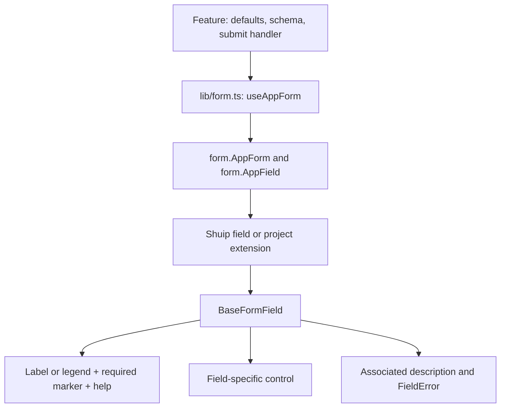

# Architecture Context

## Stack

| Layer     | Technology                   | Role   |
| --------- | ---------------------------- | ------ |
| Framework | [e.g. Vite + TypeScript]     | [Role] |
| UI        | [e.g. Tailwind + shadcn/ui]  | [Role] |
| Auth      | [e.g. supabase auth]         | [Role] |
| Database  | [e.g. supabase + PostgreSQL] | [Role] |

## System Boundaries

### Refine resources and business commands (agreed standard)

Refine owns resource CRUD, table query state and the resource cache, backed by TanStack Query. CRUD pages use Refine core `useForm` for loading, create/update mutations, invalidation and redirect helpers; TanStack Form remains the field/value/validation state layer. Feature commands use Refine `useCustomMutation` through a named provider and explicitly invalidate affected Refine queries.

The [resource migration plan](./resource-migration-plan.md) specifies proposed views, filters, search, sorting, pagination, forms and delivery phases for the legacy admin. Its [route inventory](./legacy-admin-route-inventory.md) maps all 88 source page routes and the 58 navigation tabs/permissions. These documents are a plan and source audit, not evidence that the resources or RPCs are implemented or deployed.

| Operation                                           | Owner                                                                      | Supabase access                                           |
| --------------------------------------------------- | -------------------------------------------------------------------------- | --------------------------------------------------------- |
| List/detail reads                                   | Refine `useTable`, `useList`, `useOne`                                     | Existing Supabase data provider                           |
| Create/update/delete a resource                     | Shared CRUD hooks under `src/hooks/resources/`, using Refine mutations      | Selected Refine data provider                            |
| Run an order or another business command             | Shared command controller using Refine `useCustomMutation`                 | Named provider custom command using existing tables/RPCs |
| Column sorting, filters and pagination              | Refine table state                                                         | Provider applies these to the database query              |
| Persist numeric row positions after drop | Shared resource reorder hook using Refine `useUpdate` | Existing named provider and RLS; per-row writes |

#### CRUD resources and tables

Boolean table fields can opt into inline CRUD through `createResourceSwitchColumn({ field, label })`. The column registers its boolean field in metadata; the resource controller exposes that allowlist, named-provider identity and existing edit/record rules through the thin resource context. A shared per-cell hook performs fresh access/record checks and a pessimistic Refine `useUpdate` for that single field, then awaits list/many/detail invalidation. The existing shadcn Switch renders pending/disabled states and Arabic feedback. Feature columns contain no mutation/cache logic, and workflow commands do not become generic boolean updates.

Resource forms keep their configured `defaultValues` synchronized with successful resets through `useResourceFormBaseline`. Its baseline advances immediately before TanStack `form.reset`; otherwise TanStack's next option-update effect can restore the original record after fields become untouched. Background reads and failed submissions do not advance that baseline. This is form configuration, not another resource cache or copy of live field state.

Page forms submit through `useResourceFormSubmission`, exposed as `context.submit` by the resource page composition. Features provide preparation/payload mapping and a form-reset callback only. The shared hook owns save/upload error feedback, one Refine invalidation, the authoritative edit refresh, upload cleanup, and redirect after reset. Context providers accept prepared values. Refine `useForm` still owns queries and mutations; page automatic invalidation is disabled once so the shared submission hook can await its declared targets. Dialogs retain automatic Refine invalidation.

- Register resources in the existing resource registry and reuse `ResourceView` and resource dialogs. Keep list/table state, detail reads, CRUD mutations, submission guards and cache invalidation in `src/hooks/resources/`; keep presentation in `components/resources/`. Feature fields, schemas, defaults and allowlisted payload mapping stay in the feature.
- Ordinary field edits use Refine CRUD mutations. Business operations with transition rules or coordinated writes use an explicit command such as `confirm_order`; the UI does not implement those operations as an unrestricted status update.
- Configure sorting with `refineCoreProps.sorters` / Refine `setSorters`, and let the Supabase provider apply it before pagination. Use a stable secondary key such as `id` when primary sort values can tie. Display sorting does not write a stored sequence.
- Keep reads in Refine so tables, details, counts and selectors share its query keys. Do not introduce parallel feature query caches for the same resource data.

#### Command flow and cache ownership

1. A compound action or custom button reads one typed descriptor from `useResourcePage`, such as `order.actions.startPreparation`; its button props, menu props, confirmation and execution all come from the same command controller.
2. The controller performs a fresh Refine access check and record-eligibility check, validates command input, then calls `useCustomMutation` with a named provider command identifier and retries disabled.
3. The provider verifies the current Supabase session and applies an allowlisted command using existing tables and already deployed RPCs. Existing RLS and database triggers remain authoritative. UI permission checks do not narrow direct database access.
4. After success, the controller calls Refine `useInvalidate` for the orders list/detail and other declared affected resources. Cache keys and query state remain owned by Refine's QueryClient.
5. Conditional status and `updated_at` checks detect stale writes. A conflict prompts refresh and intentional retry. Follow-up notifications/audit/payout work may fail after the order transition; the UI reports partial completion and never replays the transition automatically.

Order command contracts, eligibility and UI copy belong in `features/orders/`; execution is exposed through the named `orders` provider's `custom` method. Shared resource components render typed descriptors but remain unaware of order rules. Reuse schemas from `src/lib/schema/` where applicable.

#### Backend change restriction

Do not add or modify Supabase functions, migrations, schema, policies, Next.js APIs, or deployments without separate authorization. This is an explicit project constraint. The orders provider uses only existing tables, policies, triggers and already deployed RPCs. Existing broad admin order RLS is unchanged; client-side `canManageOrders` gates the UI but does not prevent a signed-in admin client from making other database requests allowed by RLS. XPay callbacks remain authoritative for payment; the admin must not manually confirm XPay payment or upload receipts.

#### Saved row ordering

- `ResourceView` accepts `orderField="sort_order"` (or another numeric position column). This enables drag handles and default field/ID ascending sorting without feature mutation callbacks. Without an order field, the existing `enableRowReordering` mode remains a local preview.
- Only `onDragEnd` schedules persistence. The shared drop scheduler waits for `DEFAULT_DEBOUNCE_MS` (300 ms); later drops replace the pending sequence. Navigation, filter/sort/source changes and unmount cancel pending work. Dragging is disabled while the active batch saves.
- Fresh sort authorization precedes a complete paginated read through the existing named Refine data provider. The read uses permanent scope filters, including platform ownership, and is an operation snapshot, not a parallel cache. Selected visible IDs exchange their existing global slots, preserving unselected sequence positions. Unique numeric ranks are retained; duplicate/null ranks normalize the complete scoped sequence to zero-based positions.
- Shared persistence calls Refine `useUpdate` only for changed rows and only the configured field. Mutations are pessimistic with retries and per-row invalidation disabled. One final `useInvalidate` refreshes all resource queries under the same provider. A partial failure also invalidates, restores the server view and reports partial completion without replaying writes.
- These explicitly requested per-row updates are not transactional and do not guarantee atomic concurrent reordering. No new RPC, migration, schema, policy or deployment is included. Store-order business transitions remain commands and do not use this row-position mechanism.

#### Adoption status

This is the standard for resource commands and page forms. CRUD uses Refine `useForm`; feature field state remains in `useAppForm`. Notification mark-all-read continues through its existing `useCustomMutation` adapter. No parallel TanStack Query cache or separate CRUD lifecycle is introduced.

### Application error handling

- `AppErrorBoundary` in `components/route-states/` wraps the full application in `main.tsx`, outside Suspense, development tools, theme/direction/tooltip providers, router and toaster. Render/lifecycle failures outside route boundaries reuse the shadcn `RootError` screen with retry (remount children) and full reload actions. It has no dependency on Refine, router or theme context and supplies RTL explicitly.
- TanStack Router continues to use `RootError` for route failures. User-facing error copy is generic; raw details appear only in development. Error boundaries do not catch Vite import/compilation failures, event-handler exceptions or arbitrary rejected promises; request/form handlers retain their existing error states. Restart the dev server after branch switches that remove/recreate Vite config or imported modules if its resolver retains stale failures.

### Shared admin session and identity

- `routes/__root.tsx` composes the shared admin shell.
  `providers/refine/admin-access-provider.tsx` owns Refine authentication and
  permission/identity/branding queries, protected mounting,
  redirects and shared initial loading. The Refine boundary is composed in `providers/refine/provider.tsx`
  and exported as `RefineProvider`; the root route no longer contains Refine's
  resource/provider registry.
- `providers/refine/provider.tsx` composes the Refine configuration. Auth, i18n,
  notifications, router and resources each have a sibling file in
  `providers/refine/`. The named data-provider registry and all of its adapters
  live together in `providers/refine/data-provider/`; feature screens import a
  feature action from that folder only when their UI flow needs it.
- The named adapter map uses `default` and `siteSettings` for the shared RLS
  Supabase adapter in `data-provider/supabase-data-provider.ts`, plus
  `notifications`, `mediaLibrary`, `account`, `users` and `orders` for their scoped
  adapters. The users adapter invokes the protected
  `admin-users` Edge Function; list filters, sorting and pagination are sent to
  the server through `data-provider/users-query.ts`.

The route-to-provider flow and current module layout are documented in
[`doc/application-architecture.md`](../doc/application-architecture.md).

### Shared admin layout

- The root route owns the single `AdminLayout` instance for authenticated admin
  pages. Feature route-group files render only their nested `Outlet`, so pages
  do not wrap themselves in the sidebar/header shell.
- `/sign-in`, OAuth callback/link routes and `/reset-password` stay outside the
  admin shell so auth screens remain full-screen. The shell reads the current
  TanStack Router pathname to display the matching Arabic breadcrumb label.

- `createAdminAuthProvider` shares one verified user/profile read between Refine `check`, `getPermissions` and `getIdentity`. Successful eligible-admin results stay in browser memory for 60 seconds; simultaneous calls share one promise. Missing users, rejected roles, archived profiles and failed reads are not cached as successful sessions. New reads still use Supabase `getUser` and the existing profile query.
- Login/logout and Supabase session-token/account changes or `USER_UPDATED` invalidate the cache. A version prevents older in-flight requests from repopulating it after invalidation. The Supabase listener is synchronous, registered before React access checks, and unsubscribed during hot reload. Repeated same-session `SIGNED_IN` events do not invalidate the cache.
- `AdminAccessProvider` mounts one Refine `useGetIdentity` after authentication, in parallel with permissions/branding. Its versioned identity cache holds name/avatar/email/role before the shell mounts. `getIdentity` maps the same cached verified session, so no extra backend user/profile read occurs. `useAdminIdentity` returns the actual central query result through context. Profile saves invalidate the session; focus refetches identity and permissions together using one fresh adapter read. Detailed profile/Google-link fields remain a separate profile resource query.
- The shared Refine access gate rejects unavailable/unauthorized sessions. Account switches, logout and user updates invalidate its versioned queries; focus and expired-snapshot navigation refresh permissions. Same-session background refresh preserves open forms, while errors deny access. The short cache is for browser navigation/display only; existing database RLS and server authorization remain authoritative for data access and mutations. No persistent identity cache or database change is introduced.

### Site branding and home navigation

- `AdminAccessProvider` calls `hooks/auth/use-admin-branding.ts` once. After an active admin session is verified, branding and permissions start together. Refine `useOne` reads only site name/logo/favicon from `site_settings` / `general` through the named `siteSettings` adapter. Its metadata includes the session version and profile ID, so another account cannot reuse an old result.
- The shared loader waits for the initial branding request to settle alongside permissions. Failed/empty branding uses the existing site-name fallback; authentication, identity or permission failures still block access. Sign-in, OAuth/link and reset routes disable branding reads. No second branding/identity provider mounts after the access gate.
- Branding uses five-minute freshness, no polling/focus refetch and immediate garbage collection of unused session keys. No localStorage or configuration writes. The branding hook synchronizes/removes its own favicon link and accepts only HTTP/HTTPS image URLs.
- `SiteBranding` reads the shared access context: expanded/mobile sidebar uses the logo and collapsed sidebar uses the favicon. Existing image-level Skeleton/fallback behavior covers image bytes loading after metadata is ready.
- Header home navigation goes through `/`, selecting products, users, then profile from the validated permission snapshot.

### Header notifications (implemented)

- `features/notifications/use-header-notifications.ts` owns the current-user read model through the shared context `useAdminIdentity` and two Refine `useList` queries. Both filter `recipient_profile_id` explicitly; the recipient is included in Refine's cache keys. Queries stay disabled without an identity and do not use previous-recipient placeholder data.
- The central Refine registry and any nested showcase context expose `notificationsDataProvider` under the named `notifications` provider; it delegates normal reads to the existing shared Supabase data provider. Notification hooks always specify the named provider and never depend on another context's default.
- Latest 20 rows and exact unread total are separate reads. Both poll every 10 seconds while the header is mounted in a visible tab, even if the popover is closed. Polling pauses in hidden tabs and ends on unmount. Failed refreshes retain successful cached data, expose a visible error and allow manual retry; an unknown unread total is not displayed as zero.
- `NotificationsPopover` is mounted once in `AdminLayout` for desktop/mobile, uses shadcn Popover and semantic tokens, and formats timestamps in `ar-EG` / `Africa/Cairo`. It renders plain notification text and a local link to `/notifications`; stored notification links remain inactive. Shared `NotificationItem` uses semantic primary colors for unread items and muted colors for read items, with explicit status labels. `/notifications` lists all current-user notices with 20-row pagination and the same read/error/polling behavior.
- `MarkAllReadButton` invokes Refine `useCustomMutation` through the named provider using the logical command `notifications/mark-all-read`. The adapter verifies the shared client session with `auth.getUser`, rejects a changed expected identity, and updates only `is_read` on that verified user’s unread rows in one database statement. It does not enumerate IDs, so pagination and the 1,000-row response limit do not restrict the update. Submission is guarded while pending, mutations do not automatically retry, and failures stay visible. Success invalidates notification list queries (including the count). Existing RLS remains authoritative; no schema changes, sends, deletes or Realtime subscriptions were introduced.

### Validation schemas (implemented)

- `src/lib/schema/` is the shared validation layer for auth and legacy admin feature families. Only auth, platform products and add-ons currently consume it in live admin UI. It exports Zod schemas, inferred input/output types and separate form/action/read registries through `index.ts`; it does not import feature code or execute requests.
- Existing client product/add-on input rules were reviewed as reference. Admin form values preserve numeric strings; feature models own defaults, row adapters and allowlisted database payload mapping. Schema extraction preserves existing admin validation behavior. See `src/lib/schema/README.md` for scope and source differences.

### Form field presentation architecture

All admin forms use the shared Shuip/TanStack field system. A feature chooses the field, label, description and validation rules; the shared field components present them consistently in pages, dialogs and sheets.

#### Ownership and composition



| Layer                  | Location                                                                        | Responsibility                                                                                                       |
| ---------------------- | ------------------------------------------------------------------------------- | -------------------------------------------------------------------------------------------------------------------- |
| Feature form           | `features/<feature>/`                                                           | Defaults, schema, field selection, copy, option loading, pending state and submit/payload mapping                    |
| Form factory           | [`src/lib/form.ts`](../src/lib/form.ts)                                         | Single `createFormHook` registration; exports `useAppForm`, `withForm`, `withFieldGroup`                             |
| Shared context         | [`form-context.tsx`](../src/components/ui/shuip/tanstack-form/form-context.tsx) | Single `fieldContext` / `formContext` pair used by every field and form action                                       |
| Field adapter          | [`ui/shuip/tanstack-form/`](../src/components/ui/shuip/tanstack-form/)          | Reads `useFieldContext<T>()`; binds value, change and blur; supplies control IDs, disabled state and ARIA attributes |
| Field presentation     | [`base-form-field.tsx`](../src/components/forms/components/base-form-field.tsx) | Label/legend, required marker, description help, normalized errors and vertical/horizontal layout                    |
| Description help       | [`field-help.tsx`](../src/components/forms/components/field-help.tsx)           | Shared `FormFieldHelp`, also exported as `DescriptionBadge` and `FieldHelp`                                          |
| Primitives and layouts | `components/ui/`, `components/forms/layouts/`                                   | shadcn controls, FieldGroup, dialogs, sheets and sections                                                            |

Keep value binding in the adapter and validation/business rules in the feature. BaseFormField handles presentation and reads field metadata when available; it does not create form state, perform requests or save records. Refine continues to own resource mutations and their cache as described above.

#### Visual contract

The default field presents a label row, the control, then an error when invalid. The label row contains the label, an optional required `*`, and optional description help. Hidden description text remains associated with the control independently of whether the tooltip is open.

| Presentation      | Convention                                                                                                                                                         |
| ----------------- | ------------------------------------------------------------------------------------------------------------------------------------------------------------------ |
| Label             | Clear feature-owned Arabic text; ordinary controls use `FieldLabel` with `htmlFor` matching the control ID                                                         |
| Required          | Set the field's top-level `required` prop for the marker and supported control semantics; enforce required values in the schema too                                |
| Description       | Pass `description` for field-level help. The agreed design is a small help Badge/icon beside the label with tooltip content; omit it when the description is empty |
| Error             | Render below the control using shadcn `FieldError`; strings and Zod issues are normalized by [`form-errors.ts`](../src/lib/form-errors.ts)                         |
| Invalid state     | `data-invalid` on the field wrapper and `aria-invalid` on the control, with an error ID in `aria-describedby`                                                      |
| Disabled state    | Wrapper `data-disabled` plus actual control `disabled`; a visual wrapper alone does not prevent editing                                                            |
| Checkbox          | Horizontal composition, control first and label/help alongside it                                                                                                  |
| Radio/time groups | `variant="fieldset"`, `FieldSet` and `FieldLegend`, with individual option/subcontrol names                                                                        |
| Unlabeled control | Supply an accessible name; BaseFormField render props expose `aria-label`. Help can render separately when no visible label exists                                 |
| Direction         | Inherit RTL, use logical spacing and start-aligned errors. Set LTR on values that need it, such as email, URLs and time parts                                      |

Description help is supplementary: keep instructions needed to complete a task visibly available in the surrounding form. The shared help trigger must be keyboard focusable, have an accessible name and use `type="button"` so opening help cannot submit a form. Field descriptions use `description`; the optional Shuip `tooltip` prop is a separate control-addon affordance and should not duplicate that description.

**Current implementation gap:** `field-help.tsx` currently places an `aria-hidden` icon directly inside `TooltipTrigger asChild`; it does not render the Badge/button or use its `label` for an accessible trigger name. The Badge/button and keyboard-access requirements above describe the agreed presentation contract and still need to be restored in that helper. This documentation update does not change runtime components.

#### Field APIs and value shapes

Use the actual registered Shuip component names. Native input/selection attributes belong in `props`; date fields expose their own `disabled`, `locale`, bounds and, where supported, `triggerProps`. `fieldProps` configures the outer Field; it does not bind or disable the child control. Check each field's exported interface rather than assuming all fields accept identical props. BaseFormField itself accepts React-node labels/descriptions; most installed Shuip adapters currently accept strings.

| Field                                          | Value and use                                                                                                                                                                                                           |
| ---------------------------------------------- | ----------------------------------------------------------------------------------------------------------------------------------------------------------------------------------------------------------------------- |
| `InputField`, `TextareaField`, `PasswordField` | Text. Numeric InputField uses numeric defaults and `props.type="number"`; an emptied numeric input can produce NaN, so validate it                                                                                      |
| `AutocompleteField`                            | Text with static suggestions or asynchronous search; users may enter text outside the suggestions                                                                                                                       |
| `SelectField`                                  | One stored string; options map display labels to stored values, for example `{ "نشط": "active" }`                                                                                                                       |
| `ComboboxField`                                | Stored string, or string array with `multiple`; options are `{ label, value }` records; supports asynchronous search                                                                                                    |
| `CheckboxField`, `RadioField`                  | Boolean, or one option's string value respectively                                                                                                                                                                      |
| `DateField`, `DatetimeField`, `MonthField`     | `Date \| undefined`; MonthField normalizes the selection to the first day of the month                                                                                                                                  |
| `DateRangeField`                               | `{ from, to? } \| undefined`, with date values and possibly an unfinished selection                                                                                                                                     |
| `TimeField`, `TimeRangeField`                  | HH:mm string, or `{ start, end }`; the feature schema owns required/range rules                                                                                                                                         |
| `InlineEditField`                              | String; commits validate and invoke the owning form's submit handler. Use a dedicated form when saving should affect only that value                                                                                    |
| `ImageUploadField`, `AttachmentsField`         | `ImageUploadField` stores saved URLs or queued UploadCN IDs and reads a named upload slot from a resource page; `AttachmentsField` stores local `File[]` |

Catalog price and sort-order forms intentionally keep numeric strings using `inputMode`. Feature code converts values into allowlisted API payloads, including explicit date/time serialization where needed. A Date object in form state does not define the database's date or timezone contract.

#### Standard feature form

```tsx
import { useAppForm } from "@/lib/form";
import { FieldGroup } from "@/components/ui/field";

const form = useAppForm({
  defaultValues,
  validators: { onChange: schema, onSubmit: schema },
  onSubmit: async ({ value }) => onSave(toPayload(value)),
});

return (
  <form.AppForm>
    <form
      id={formId}
      noValidate
      onSubmit={(event) => {
        event.preventDefault();
        event.stopPropagation();
        if (!saving) void form.handleSubmit();
      }}
    >
      <FieldGroup>
        <form.AppField name="name">
          {(field) => (
            <field.InputField
              label="الاسم"
              description="الاسم الذي يظهر في الكتالوج."
              required
              props={{ disabled: saving }}
            />
          )}
        </form.AppField>
      </FieldGroup>
      <form.FormErrorSummary />
      <form.FormActions>
        <form.SubmitButton props={{ disabled: saving }}>حفظ</form.SubmitButton>
      </form.FormActions>
    </form>
  </form.AppForm>
);
```

`defaultValues`, `schema`, `onSave`, `toPayload`, `formId` and `saving` are supplied by the feature. For a dialog footer outside the native form, keep it under `form.AppForm` and pass `props={{ form: formId, disabled: saving }}` to SubmitButton. SubmitButton combines caller-disabled state with TanStack's `isSubmitting` / `canSubmit`. Mutation failures remain visible through the owning feature; `FormErrorSummary` supplies generic form-validation feedback.

For a new control, first choose an installed Shuip field. If a project-specific adapter is necessary, read the existing shared `useFieldContext<T>()`, render BaseFormField once, bind value/change/blur and register it in `src/lib/form.ts`. Use BaseFormField's render-function children to obtain generated IDs, required/disabled values and ARIA associations; spread them onto compatible controls or map them to the control's API. For ordinary children, supply `htmlFor` and wire matching control attributes explicitly. Custom controls without a labelable HTML element use `labelTarget="labelledBy"` and must apply the supplied `aria-labelledby` themselves.

#### Adoption and verification

All 15 Shuip field types, shared context and SubmitButton are installed from `@shuip`; registry code is owned locally and composed with the existing Radix/shadcn primitives. Catalog create/edit, sign-in, Refine/overlay demos and image-upload demo use the shared factory. The image demo requires an explicitly configured Cloudinary adapter before uploading. `/fields` is the field gallery, with base-field and image-upload examples. Legacy wrappers, the duplicate factory/context adapters and duplicate standalone showcase/schema were removed; reusable dialog/sheet/section layouts remain.

When changing a field, verify label/control association, description access by keyboard, required/error presentation, actual disabled behavior, RTL and the field's value shape. For submission changes, also verify the owning page/dialog flow and pending/error handling. These checks complement TypeScript and the production build.

### UploadCN and Cloudinary media uploads

The Vite admin owns `/uploads`. Its named Refine `mediaLibrary` data provider calls the existing Supabase backend through the `media-library` Edge Function. Next.js is not required. Cloudinary stores the files; no new database table or migration is introduced.

- `features/uploads/page.tsx` presents a searchable image grid, folder filters, oldest/newest sorting and cursor pagination. Refine owns reads, metadata updates, deletion state and cache invalidation.
- The upload dialog composes the installed `ImageUpload`, `AvatarUpload`, `LogoUpload` and `ProductMediaUpload` blocks from `components/upload`. They share the signed Cloudinary adapter, supported image formats and 5 MiB preflight limit. Pending uploads prevent closing the dialog or changing folder/type. Product cover/reordering is a local preview, not a persisted product association.
- `components/ui/upload.tsx` owns reusable queue/progress/actions and pending-state reporting. Crop preparation remains in the installed image cropper and crop queue. `FileUpload` remains available for other integrations.
- `hooks/uploads/use-library-upload-adapter.ts` requests the existing server-authorized signature through the media-library provider, then UploadCN sends file bytes directly from the browser to Cloudinary. No Cloudinary SDK or Next route is needed.
- `client/supabase/functions/media-library/index.ts` implements list, get, sign, update and delete. It validates the Supabase JWT with `auth.getUser`, current profile/archive state and content-management permission. Only active super admins and authorized general supervisors are accepted. Its gateway JWT check is disabled because the function performs this validation itself.
- Search and mutations are scoped to public `alrehla/` images, excluding `alrehla/private/`. Signing accepts exact allowlisted parameters and folders, a fresh timestamp, overwrite disabled and the signed `alrehla_media_library` preset. CORS permits configured origins only.
- Metadata updates preserve the asset URL and public ID. Deletion rechecks existing resource references and fails closed if scanning cannot complete. Service-role access is limited to that authorized reference scan; Cloudinary credentials and the service key stay in Supabase secrets.

The browser uses `VITE_SUPABASE_URL`, its publishable key and `VITE_CLOUDINARY_CLOUD_NAME`. Backend secrets are `CLOUDINARY_CLOUD_NAME`, `CLOUDINARY_API_KEY`, `CLOUDINARY_API_SECRET` and `MEDIA_ALLOWED_ORIGINS`. The function is deployed to the current development Supabase project; deployment of the Vite frontend is separate.

Cloudinary has account-level size ceilings, not per-preset byte limits. The 5 MiB client/declared-metadata checks are preflight checks, not server inspection of direct-upload bytes. Private documents need an explicit protected-delivery design. Removing a queue item only clears local state and does not delete the remote asset.

Forms use the shared `useAppForm` factory. Resource page definitions declare named upload slots (folder, accepted formats, size and file limits); `ResourceUploadSlots` and `useResourceUploadSlot` create the signed adapter and non-auto-starting UploadCN queue. The registered `ImageUploadField` reads its slot, composes `BaseFormField`, preserves queue/progress/preview/removal UI, and stores saved URLs or queued file IDs. A feature may compose its own media picker into the field. Before product CRUD save, the feature asks the shared page resolver for the selected image URLs; it rechecks upload permission and awaits every selected upload. A failed/rejected/cancelled upload or invalid result rejects preparation and therefore never reaches Refine's create/update mutation. The field keeps queue state locally; only URLs/public IDs supported by the owning resource schema enter the payload, never Files or upload engine state. Upload success and saving a resource association remain separate operations.

The shared slot shows upload progress only for IDs being resolved by the active Save submission; queued files remain quiet and removable beforehand. Successful browser-direct Cloudinary uploads invalidate `uploads` list/many queries through the named `mediaLibrary` provider so the picker sees new assets. The shared page composer disables Refine's automatic mutation invalidation once. `useResourceFormSubmission` owns one awaited Refine list/many/detail invalidation, edit detail refresh, upload cleanup, reset and create redirect; feature forms call `context.submit({ prepare, reset })` and contain no CRUD cache or toast orchestration. The reset callback receives the authoritative detail row, including when a cover URL is removed or replaced. Removing the association does not delete the Cloudinary asset.

The previous `/api/upload/sign` implementation was removed. Supabase now supplies the existing backend connection for the Vite uploads page. See `components/upload/README.md` for integration and deployment details.

### Resource pages and business commands (implemented)

- `ResourceView` owns list/table composition and gates list access before the table controller mounts. `ResourceContextProvider` and `ResourcePageContextProvider` are separate thin providers: the former carries table/dialog selection; the latter carries a prepared form or details record, action descriptors and request state.
- `createResourcePage` is a module-scope factory with `kind: "form"` and `kind: "details"` contracts. It exposes stable bound Page/Fields/Footer/DirtyGuard/Action/ActionMenuItem/CommandDialogs components. `useResourcePage(definition)` is the typed context reader in `hooks/resources/page/`.
- Ordinary create/edit uses Refine core `useForm` through the thin `useResourceFormCrud` adapter. Refine owns the edit query, mutation, redirect helper and automatic CRUD invalidation. TanStack `useAppForm` owns feature form values/validation/dirty/submitting state. Fresh authorization and record restrictions remain explicit preflights. Products use `/catalog/products/create` and `/catalog/products/:id/edit`; add-ons use the form contract in dialog mode; the users form remains intentionally incomplete.
- Details pages use one Refine `useOne` record query and no form or implicit Save action. `useResourceCommands` uses one Refine `useCustomMutation` path for button props, menu props and confirmation/input dialogs, rechecks access and record eligibility, blocks duplicate execution and calls `useInvalidate` for declared targets. Pending and mutation errors come from Refine.
- Orders are registered as a named `orders` provider with `/orders` and `/orders/:id`. The list uses Refine server table state; the provider batches current-page item/profile/product lookups. The details context supplies order data and feature-owned command contracts cover fulfillment, cancellation, electronic-delivery recording and idempotent publisher-earnings recovery.
- Order transitions recheck session/permission, compare expected status and `updated_at`, and use a conditional update. Existing audit, notification and payout effects remain follow-up operations; failures are surfaced as partial success and never replay the status transition automatically. XPay callbacks remain authoritative.
- No Supabase functions, migrations, schema, policies, Next.js APIs or deployments were added or changed. Existing broad admin order RLS is unchanged; `canManageOrders` controls the UI but does not narrow direct database access. See [`doc.md`](../doc/doc.md) for the detailed component/hook flow.

## Storage Model

- **[Storage type e.g. Database]**: [What lives here —
  e.g. metadata, ownership, relationships]
- **[Storage type e.g. Blob/File Storage]**: [What lives
  here — e.g. generated files, media, large artifacts]

## Auth and Access Model

- [How authentication works — e.g. Every user signs in
  via Clerk]
- [How ownership works — e.g. Every project has a single
  owner]
- [How access control works — e.g. Only the owner or a
  collaborator can mutate project resources]

## Invariants

1. [Rule the codebase must never violate — e.g. Request
   handlers do not run long-lived background work]
2. [Invariant two]
3. [Invariant three]
4. [Invariant four]

### Shared Refine authorization — 2026-10-31

`providers/refine/access-control-provider.ts` is the frontend permission policy.
The existing auth adapter shares verified profile and permission reads for up to
60 seconds; supervisors read `admin_roles.permissions` by `admin_role_id`, or the
default group when no group is assigned. Failed/missing group reads deny access.
Super admins need no permission-group lookup. Session invalidation clears both
snapshots and rejects stale in-flight reads. A fresh mutation preflight bypasses
the snapshot without replacing Refine mutation state.

`hooks/resources/authorization/use-resource-authorization.ts` wraps Refine `useCan`, adding the
session version and permission-snapshot revision to the generated query key through
params. Initial results are seeded from the validated shared actor. The shared
access provider owns focus refresh; errors cannot reuse an old grant. `ResourceView` gates list access
before mounting the table, combines CRUD/sort grants with existing feature
restrictions, and guards dialog opening. Shared CRUD hooks recheck access before
submission. Custom `ResourceRowAction` entries require `authorizationAction`;
unregistered actions and empty menus are hidden.

The sidebar uses `adminNavigationGroups` beside the Refine resource registry and
`AuthorizedSidebarItem`, sharing the same list checks as pages. Empty groups are
hidden, pending checks use skeletons, and errors offer Arabic retry actions.
Standalone profile/uploads/notifications routes use `ResourceAccessGate` inside
the existing root AdminLayout. Sign-in redirects through `/`, selecting products,
users, then profile in permission order.

Catalog CRUD/sort requires `canManageCatalog`; media requires `canManageContent`.
Both active admin roles retain ordinary users management without
`canManageUsers`; user deletion and assigning admin roles require super admin.
Own-profile and own-notification boundaries and protected user records remain.
These are frontend checks: existing catalog RLS still grants broader admin access.
No schema, RLS, Edge Function, remote configuration or deployment changes are part
of this feature. Existing server checks remain authoritative.


### Shared Refine auth and permission loading — 2026-11-01

Root and home routes no longer await authentication or permissions in `beforeLoad`.
`AdminAccessProvider`, mounted inside Refine before AdminLayout,
combines `useIsAuthenticated`, dependent `usePermissions` and `useGetIdentity` query states into one
initial loading boundary. `authProvider.getPermissions` delegates to the existing
shared authorization adapter. Authentication results include the verified profile
ID; the permission snapshot must match it before children mount. Failed reads
produce retryable Arabic feedback; missing/ineligible sessions cannot enter.

OAuth callback/link and reset-password flows bypass bootstrap. Sign-in checks only
authentication and redirects authenticated users to `/`; the home component selects
products, users, then profile from the ready permission snapshot. No protected page data
queries mount before bootstrap. Branding is part of bootstrap and starts alongside
permissions after authentication; identity uses Refine useGetIdentity backed by that same verified session. Refine resource/action checks, record restrictions
and fresh CRUD preflights remain in place. Table loading stays independent.

Session-version changes remove protected children immediately. Focus uses one fresh
adapter request shared with Refine permission and identity refetch; background checks retain
same-session form/upload state, but errors or denials remove access. Route changes
refresh snapshots older than 60 seconds. There is no new persistent cache or backend
policy, schema, configuration or deployment change.
