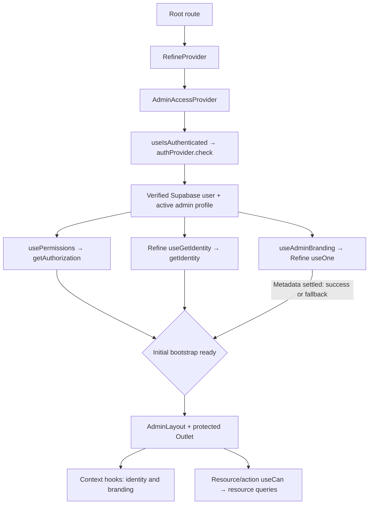

# Admin access, identity and branding

## Result and flow

`AdminAccessProvider` coordinates authentication, permissions, identity and branding
under one initial loading boundary. The former identity/branding providers are
removed. One Refine `useGetIdentity` query runs inside this boundary and caches
name, avatar, email and role before the shell mounts. Its adapter reuses the
already verified user/profile read.

The identity, branding and permission-group requests begin together once authentication
has verified an active administrator. Permission/identity IDs must match the
verified profile before the shell mounts. Callback/link/reset routes bypass the
gate; sign-in checks authentication without reading branding or permission groups.

## Ownership and cache

Refine owns auth, permission and identity query state plus the branding resource query. The auth
adapter owns the existing 60-second verified-session/authorization cache and
concurrent-request sharing. Its authorization result contains permissions;
`getIdentity` maps the same verified session into the separate identity query.
The identity query key is `["admin-identity", sessionVersion]`, with 60-second
freshness, no automatic retries/focus refetch and immediate collection when unused.
`useAdminIdentity` returns this actual Refine query result through context,
including its data, error, pending state and refetch; consumers start no extra query.
Normal bootstrap needs
one verified user read and one profile read, followed by the applicable permission
group lookup; identity introduces no additional request.

Branding reads only the site name/logo/favicon from `site_settings` / `general`
through the named `siteSettings` data provider. Refine metadata includes the auth
session version and profile ID, retaining normal Refine resource query keys while
isolating accounts. Branding uses five-minute freshness, no polling/focus refetch,
and immediate collection of unused session keys. No credentials or persistent
browser cache are introduced.

Session invalidation clears the shared snapshots and changes query keys. A late
old-session result cannot restore identity or branding in the current context.
Same-session focus refresh refetches permissions and identity through one fresh
adapter read and preserves open forms. Profile saves invalidate the session so name/avatar changes reach all
consumers through the new session-version identity query. Existing server authorization remains
authoritative; this refactor changes no backend policies or writes.

## Components and hooks

Paths below are relative to `admin/src/`.

| File / export | Responsibility and data flow |
|---|---|
| `routes/__root.tsx` / `RootLayout` | Composes Refine → AdminAccessProvider → standalone outlet or AdminLayout. Has no separate identity/branding wrappers. |
| `providers/refine/admin-access-provider.tsx` / `AdminAccessProvider` | Combines Refine useIsAuthenticated, usePermissions, useGetIdentity and branding queries; handles redirects, shared loading, critical failure/retry, session refresh and context publication. |
| `providers/refine/auth-provider.ts` | Verifies user/profile, reads assigned/default permission group, maps `AdminIdentity` from the same session, caches/shares reads and rejects outdated results. `getIdentity` supplies the central Refine identity query without another backend read. |
| `hooks/auth/use-admin-access.ts` / `useAdminAccess` | Reads the shared actor, identity, branding, loading/error/retry and snapshot versions; resource checks use this validated state. |
| `hooks/auth/use-admin-access.ts` / `useAdminSessionVersion` | Subscribes to the adapter's session version for account-scoped query keys. |
| `hooks/auth/use-admin-access.ts` / `useAdminIdentity` | Returns the root useGetIdentity query result from context. Its refetch refreshes that same query cache. |
| `hooks/auth/use-admin-access.ts` / `useSiteBranding` | Returns normalized branding and shared loading state from the same context. |
| `hooks/auth/use-admin-branding.ts` / `useAdminBranding` | Executes the single Refine branding `useOne`, normalizes metadata, installs the favicon link, and removes it on change/unmount. Accepts explicit enabled/version/profile ID inputs. |
| `features/site-branding/model.ts` | Builds the protected branding query and normalizes site name/image URLs. Allows only HTTP/HTTPS image URLs and supplies the default site name. |
| `components/admin-layout.tsx` / `AdminLayout` | Reads ready identity for sidebar account details through the new context hook. |
| `components/refine-ui/layout/user-info.tsx` / `UserInfo` | Displays name/email from shared identity. |
| `components/refine-ui/layout/user-avatar.tsx` / `UserAvatar` | Displays shared avatar/initials using existing avatar primitives. |
| `components/site-branding.tsx` / `SiteBranding` | Reads shared branding and renders the existing expanded/collapsed/mobile presentation. |
| `features/notifications/use-header-notifications.ts` / `useHeaderNotifications` | Uses shared identity ID to enable recipient-scoped list/count queries. Identity retry refetches the shared identity query. |
| `features/notifications/mark-all-read-button.tsx` / `MarkAllReadButton` | Gets the verified recipient ID from the new hook; command and invalidation behavior remain feature-owned. |
| `features/profile/page.tsx` / `ProfilePage` | Uses shared identity ID for its separate detailed profile resource, which includes account-link/password information beyond shell identity. |
| `features/uploads/page.tsx` / `UploadsPage` | Uses the shared identity ID to scope media queries and uploads. |

The removed `features/auth/identity-provider.tsx` and
`features/site-branding/provider.tsx` have no compatibility wrappers or remaining
imports. Consumer presentation and feature mutations retain their existing behavior.

## States and verification

Initial authentication, permissions, identity and branding metadata use the same `Loading`
component. Critical auth/permission/identity failures show Arabic retry feedback and prevent
page mounting. Missing/ineligible sessions cannot enter protected pages. Branding
failure or empty metadata settles to the existing site-name fallback, allowing
otherwise authorized administrators to continue. Actual logo/favicon image loading
retains the existing image placeholders and fallbacks after metadata is ready.

Table/detail requests retain their own resource loading states. Branding and identity
are not additional post-bootstrap loading phases. Site metadata is disabled on
sign-in and all callback/link/reset flows.

Tests cover shared backend read counts, identity QueryClient cache reuse and version isolation, updated identity, branding enabled/disabled
conditions, parallel bootstrap, pending/error/fallback behavior, identity ID mismatch,
session-scoped branding metadata and favicon cleanup, alongside the existing access,
CRUD and stale-session tests. See the progress tracker for final validation results
and any live-browser verification limits.
