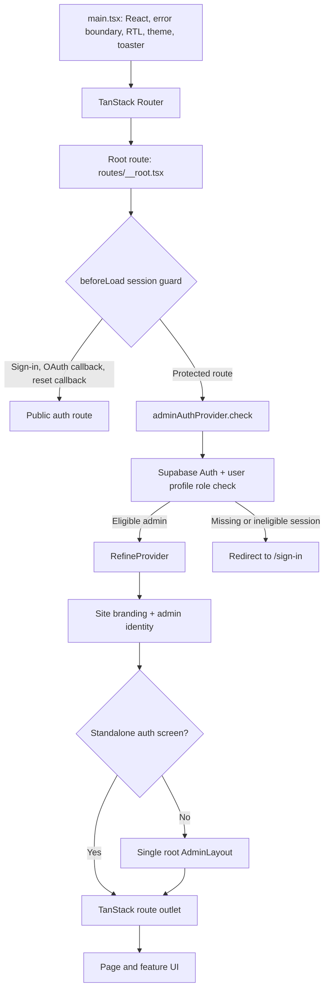
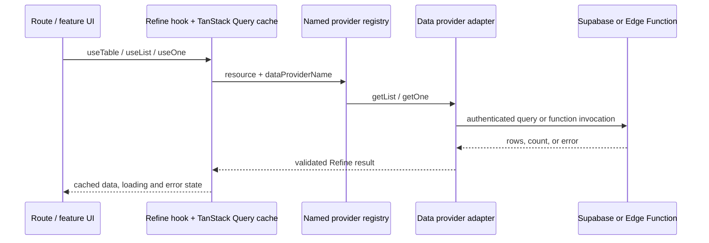
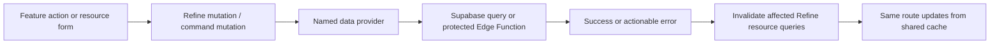

# Admin application flow and architecture

This document describes the current Vite admin application in `admin/`, its
Refine provider layout, and how a screen request reaches Supabase or an Edge
Function. It describes the current implementation; planned resources and
business commands are not assumed to exist until they are registered and
implemented.

## Application startup and route flow



`main.tsx` mounts the outer application shell: the error boundary, loading
fallback, RTL direction, theme, tooltip context, router and Arabic toaster.
TanStack Router owns URL matching and route loading. The root route checks the
session before protected pages render. Sign-in, OAuth callback/link and
password-reset callback routes must be able to finish their auth flow before a
protected-session check runs. Supabase auth events invalidate the router so a
sign-out, account change or updated user is checked again.

After the route guard, `RefineProvider` gives the live application one Refine
context. Site branding and admin identity are mounted above the route outlet so
the layout and feature pages can share them. The page itself remains a TanStack
route; Refine supplies resource data operations, table state, mutations and
resource cache behavior inside that route.

The root route renders one `AdminLayout` around all authenticated admin pages.
Route-group files under catalog, users, uploads, notifications and profile only
render their child outlet; they do not add another sidebar/header. Sign-in,
OAuth callback/link and password-reset callback screens bypass the shell. The
layout derives its Arabic breadcrumb from the current pathname.

## Provider module layout

```text
src/providers/
├── supabase-client.ts               # One browser Supabase connection/client
└── refine/
    ├── provider.tsx                 # Composes Refine configuration once
    ├── auth-provider.ts              # Admin sign-in, session, identity, OAuth
    ├── router-provider.tsx           # Refine navigation adapter for TanStack Router
    ├── resources.ts                  # Resource names, routes and named providers
    ├── i18n-provider.ts              # Refine Arabic Egypt translations
    ├── notification-provider.tsx     # Refine notifications mapped to Arabic Sonner
    └── data-provider/
        ├── index.ts                  # Default and named provider registry
        ├── supabase-data-provider.ts # Shared lazy Supabase CRUD adapter
        ├── account-data-provider.ts  # Current-user profile reads and writes
        ├── media-library-data-provider.ts # Media library Edge Function adapter
        ├── notifications-data-provider.ts # Notification reads and command
        ├── users-data-provider.ts    # Admin users Edge Function adapter
        └── users-query.ts            # Refine filters/sorters/page -> list request

src/features/<feature>/              # Feature UI, schemas, view models, actions
src/routes/                           # URL routes and route-level composition
src/hooks/resources/
├── use-resource-table.ts             # Refine list/table state and local reorder draft
├── use-resource-form-crud.ts         # Detail read, create/update, guards, invalidation
├── use-resource-delete-crud.ts       # Pessimistic delete and mutation state
└── lifecycle.ts                      # Shared resource lifecycle state helpers
```

`src/providers/refine/data-provider/` contains the shared Supabase CRUD adapter,
the named-provider registry and all specialized adapters. This is the single
location for Refine data-provider implementations. Keep form schemas, display
logic, validation messages and feature actions beside their feature; the shared
Supabase connection remains in `src/providers/supabase-client.ts`.

## Refine composition and named providers

`providers/refine/provider.tsx` passes the resource list and the auth, data,
router, notification and i18n providers to `<Refine>`. The registry in
`providers/refine/data-provider/index.ts` maps provider names to implementations:

| Refine provider name | Adapter | Data path |
| --- | --- | --- |
| `default` | `adminDataProvider` | `@refinedev/supabase` using the shared authenticated browser client |
| `siteSettings` | `adminDataProvider` | Same shared adapter for protected site branding reads |
| `account` | `profileDataProvider` | Current signed-in user's `user_profiles` record |
| `mediaLibrary` | `mediaDataProvider` | Supabase `media-library` Edge Function |
| `notifications` | `notificationsDataProvider` | RLS-backed reads plus the mark-all-read command |
| `users` | `usersDataProvider` | Protected Supabase `admin-users` Edge Function |

Resource names and optional `dataProviderName` metadata live in
`providers/refine/resources.ts`. For example, `/profile` selects `account`,
`/uploads` selects `mediaLibrary`, and `/users` selects `users`; catalog
resources use the default provider. Components can also specify the provider
explicitly for non-resource queries and mutations.

## Resource read flow



Refine owns table filters, sorting, pagination and resource query caching.
Hooks under `src/hooks/resources/` own the reusable Refine query/mutation flow;
components under `src/components/resources/` render the table and dialogs.
The form hook reads pending/error state from Refine's create/update mutations;
it keeps local flow-error state only for edit preflight checks and callbacks.
The chosen data-provider adapter translates the operation into its backend
request. The shared adapter delegates ordinary CRUD to `@refinedev/supabase` and the current
Supabase client; database Row Level Security remains authoritative. Specialized
adapters use explicit ownership/session checks where needed and call Edge
Functions for operations requiring server-side privilege. The users adapter
builds its list request from Refine search, filters, sorters and pagination in
`users-query.ts`; the function applies and validates those inputs on the server.

The common Supabase connection is lazily initialized from the public Vite
configuration and owns the browser auth session. The service-role key is never
part of the admin browser provider; privileged Auth operations stay inside the
Edge Function.

## Writes and command flow

The shared resource hooks use Refine resource mutations (`useCreate`, `useUpdate`
and `useDelete`) against the provider selected for that resource. The users
provider also exposes validated `custom` actions for user-specific commands;
notification mark-all-read uses Refine `useCustomMutation` through the named
notifications provider. These operations use Refine's TanStack Query context
and refresh the relevant provider/resource queries after success.



For a future business command such as confirming an order, keep transition
rules and atomic writes on the server (usually an authorized Postgres RPC). A
feature-owned TanStack Query `useMutation` may run that command and then call
Refine `useInvalidate` for affected resources. Reuse the QueryClient mounted by
the app; do not add a second cache for the same resource data. No order resource
or order RPC is implied by this architecture document.

Profile credential operations use Supabase Auth actions owned by the profile
feature and its auth provider. Cloudinary file bytes upload directly from the
browser with the signed UploadCN adapter; the `media-library` Edge Function
signs uploads and handles media metadata/library actions. Refine continues to
own the media-library listing and metadata CRUD cache.

## Adding another resource or provider

1. Build the route and feature UI under `src/routes/` and `src/features/`.
2. Register the resource and route metadata in `providers/refine/resources.ts`.
3. Reuse `default` for ordinary RLS-backed CRUD, or add a focused adapter file
   under `providers/refine/data-provider/` when the resource needs a separate
   backend contract or command handling.
4. Export and register the adapter in `data-provider/index.ts`, then set its
   name in the resource metadata or Refine hook.
5. Keep authorization and privileged operations in RLS, Postgres functions or
   Supabase Edge Functions; validate returned and submitted data in the
   adapter/feature as appropriate.
6. Invalidate the same Refine resource/provider queries after commands so the
   visible tables and detail views stay synchronized.

Run `pnpm typecheck`, `pnpm test` and `pnpm build` from `admin/` after changing
provider registration or request contracts.
