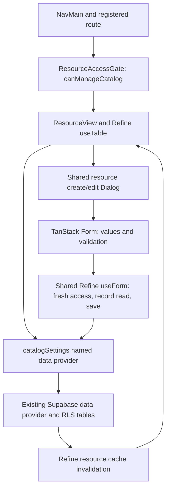

# Catalog personalization settings

## User flow and scope

The permission-aware `NavMain` group **إعدادات الكتالوج** links to three lists:

| Route | Resource | Columns | Create/edit fields |
|---|---|---|---|
| `/catalog/settings/customization-fields` | `customization_fields` | Label, placeholder, required, application scope, active switch, actions | Label, placeholder, required, all/selected scope, selected product IDs/box, active |
| `/catalog/settings/story-goals` | `story_goals` | Label, application scope, active switch, actions | Goal label, all/selected scope, selected product IDs/box, active |
| `/catalog/settings/writing-dialects` | `writing_dialects` | Arabic name, immutable code, active switch, actions | Arabic name, code on creation, active |

Create/edit and confirmed single-row delete use the existing resource **Dialog**
lifecycle. No create/edit page routes were added. The active switch updates only
`is_active` through the shared pessimistic Refine mutation, which rechecks edit
access and reads the current row before saving. Inactive items disappear from
new customer choices while existing order snapshots remain readable. The row
actions menu exposes delete when the catalog permission allows it; deletion
uses the shared confirmation and the existing Supabase RLS policy. Bulk delete
remains unavailable.

Customization fields remain short-text definitions; this change does not
introduce new input types. Empty restricted scope is invalid: users must choose
at least one product or the box. Explicit all scope writes `applies_to: null`.
Selected scope writes the existing product-ID array, including the reserved
`box` value when selected. This preserves existing storefront semantics.

Fields and goals retain `orderField` for the existing debounced persistent
row-reordering mechanism, including complete scoped position reads and one
cache invalidation after updates. The numeric order input and column are not
shown in any of the three settings screens. Create payloads omit `sort_order`
and use the existing database defaults; ordinary edits leave stored order
untouched. Dragging fields/goals still writes only `sort_order`. Dialects retain
their existing stored-order display sorting without an order editor.

The product form's future multi-select/quick-create integration is separate
work. These screens manage the existing shared definitions and their scopes.

## Request and state ownership

Refine remains the only query/mutation/cache owner. TanStack Form owns values,
validation and submission state. The shared Dialog handles pending state,
duplicate submissions, failure feedback, fresh edit records, and closing after
a confirmed save. Scope search uses Refine `useSelect` (25 matches per server
search) and its selected-ID `useMany` hydration. Searching never removes saved
selections. Failed scope reads have a visible retry action.

The named provider adapts `writing_dialects.code` to Refine's `id` through
PostgREST `id:code`, routes ID filters to `code`, and translates stable `id`
sorting to `code`. Only creation writes the code; edit rejects attempts to
change it. This uses the existing table and does not add an ID column.

Writes validate an explicit field allowlist. The provider checks catalog
authorization again before mutations and rejects an empty saved response.
Create checks the existing 15-field/30-goal limits, including inactive rows.
These count-before-insert checks are not a database transaction; simultaneous
creates can race. RLS and existing constraints/triggers remain authoritative.

## Component and module responsibilities

Paths below are relative to `admin/src/`.

| File | Responsibility |
|---|---|
| `routes/catalog/settings/*.tsx` | Three thin route wrappers; no form state |
| `features/catalog/settings/page.tsx` | Three resource lists, dialog mode, search and ordering configuration |
| `features/catalog/settings/columns.tsx` | Labels, inline active switches, scope summaries, stored-order headers and shared row actions |
| `features/catalog/settings/model.ts` | Existing database row types, form defaults and validation, scope semantics, allowlisted payload mapping and Arabic error formatting |
| `features/catalog/settings/personalization-dialog.tsx` | Field/goal form factories and their TanStack Form fields |
| `features/catalog/settings/dialect-dialog.tsx` | Dialect form factory; disabled immutable code on edit |
| `features/catalog/settings/scope-targets-field.tsx` | Searchable multi-selection of existing products and box; saved selection hydration; accessible field/error composition |
| `providers/refine/data-provider/catalog-settings-adapter.ts` | Testable provider factory, dialect identity adaptation, write allowlists and creation limits |
| `providers/refine/data-provider/catalog-settings-data-provider.ts` | Binds the adapter to existing Supabase CRUD and fresh authorization |
| `providers/refine/data-provider/index.ts` | Registers the named `catalogSettings` provider |
| `providers/refine/resources.ts` | Resource labels, list URLs, dialog/provider metadata and NavMain items |
| `providers/refine/access-control-provider.ts` | Catalog permission for lists/create/edit/delete, fields/goals sort and settings navigation |
| `components/nav-main.tsx` | Authorized collapsible settings navigation, router links, active/open state, collapsed-sidebar destination, loading/error/retry states |
| `components/app-sidebar.tsx` | Composes NavMain after the existing navigation groups |
| `components/admin-layout.tsx` | Arabic breadcrumb labels for settings routes |
| `routeTree.gen.ts` | Generated route registration |

No new feature mutation hooks or parallel query cache were introduced. Shared
resource components/hooks remain the mutation, Dialog, table and reorder
implementation. This frontend change adds no database schema, policy, RPC,
Edge Function, Next.js endpoint or deployment. It does not invoke legacy
Next.js `revalidatePath` or legacy server-action audit logging; storefront
cache behavior and existing database triggers remain as currently deployed.

## States and verification

Permission-pending, denied, list-loading, empty/error/retry and Dialog record
loading states reuse the shared resource components. The settings group uses
the same catalog permission, hides when denied, and opens automatically on a
settings route. Arabic text follows root RTL; immutable Latin codes and
numeric inputs use LTR isolation.

`tests/catalog-settings.test.mjs` uses the real provider adapter with controlled
CRUD services to verify code identity for lists/detail/selected reads/updates,
immutable keys and write allowlists, explicit global versus restricted scope,
signed integer ranks, creation caps, and unconfirmed writes. Existing resource
reorder and Dialog CRUD behavior remains covered by the shared checks.

TypeScript, production build and all 48 tests pass. The existing route-generator
circular-dependency warning and Vite chunk-size warning remain. The local
authenticated browser showed the settings navigation and new-dialect Dialog.
A separate preview tab attempt timed out, so complete browser coverage of the
three lists and all Dialog interactions was not obtained. No live settings
records were created, edited, removed or reordered during agent verification.

Order-control follow-up: removed order from all Dialog inputs, form schemas,
defaults, payload mapping and visible columns. Create uses database defaults;
ordinary edits preserve saved ranks. The focused adapter suite now has seven
passing checks, including a regression for omitted order in create/edit saves.
TypeScript and production build pass for the follow-up.
