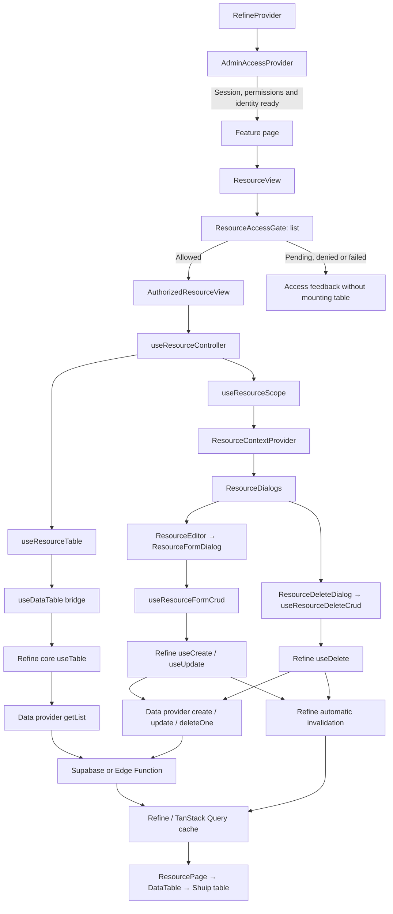

# ResourceView: flow, architecture, components and hooks

This guide describes the current `admin` implementation as of 2026-11-01. File paths below are relative to `admin/`. It distinguishes implemented behavior from the agreed extension pattern.

## 1. Ownership

| Layer | Responsibility | Location |
|---|---|---|
| Feature | Columns, fields, validation, defaults, payload mapping and record restrictions | `src/features/<feature>/` |
| Shared resource UI | Compose the table, dialogs, action buttons and access checks | `src/components/resources/` |
| Shared CRUD logic | Table queries, edit-record reads, saves, deletes and duplicate-submission guards | `src/hooks/resources/` |
| Table/Refine bridge | Map Shuip/TanStack Table search, filters, sorting and pagination to Refine state | `src/components/refine-ui/data-table/use-data-table.ts` |
| Refine | Invoke data providers; manage query/mutation state, cache keys and invalidation | `@refinedev/core` |
| TanStack Query | Request and cache engine used by Refine | The QueryClient backing the same Refine context |
| TanStack Form | Form values, validation, touched state and field errors | `useAppForm` from `src/lib/form.ts` |
| Data provider | Execute requests and map server responses to Refine's contract | `src/providers/refine/data-provider/` |
| Backend | Enforce data access and business rules | Supabase RLS and Edge Functions, depending on the resource |

`ResourceView` composes a resource screen. A `dataProvider` executes data requests. `RefineProvider` configures the whole application, while each resource page has its own `ResourceView` instance. `ResourceContextProvider` follows Refine core’s resource-context role: it only exposes registry-independent page state through React context.

## Directory layout

```text
src/
├── contexts/resource/       # Thin provider and context contracts
├── hooks/resources/
│   ├── authorization/       # Resource permission query hook
│   ├── actions/             # Row-action authorization and execution
│   ├── controller/          # Compose permissions, table and page scope
│   ├── crud/                # Create/edit/delete behavior and lifecycle helpers
│   ├── scope/               # Dialog selection and context reader
│   ├── table/               # Refine table state and local reorder behavior
│   └── index.ts             # Stable public hook exports
└── components/resources/
    ├── access/              # Permission gate and loading/denied states
    ├── actions/             # Authorized row-action menu
    ├── dialogs/             # Dialog host and delete confirmation
    ├── forms/               # Create/edit dialog composition
    ├── view/                # ResourceView and table page presentation
    ├── index.ts             # Stable public exports
    └── types.ts             # Shared resource UI contracts
```

Feature-specific schemas, defaults, columns and fields remain under `src/features/`. Refine's own resource registry and named data providers stay under `src/providers/refine/`.

## 2. Complete flow



The order matters: `AdminAccessProvider` first guards application access, then `ResourceAccessGate` checks the resource's `list` permission. The table controller remains unmounted and resource queries do not start while page access is pending or denied.

## 3. Refine configuration and data-provider selection

| File | Responsibility |
|---|---|
| `src/providers/refine/provider.tsx` | Mount `<Refine>` and register resources, data providers, authentication, access control, routing, notifications and translations. |
| `src/providers/refine/resources.ts` | Central registry of resource names, URLs, labels and navigation metadata. `meta.dataProviderName` associates a resource with a named provider. |
| `src/providers/refine/data-provider/index.ts` | Map provider names to their implementations. |
| `src/providers/supabase-client.ts` | Shared Supabase connection used by adapters. |

Refine selects an explicit `dataProviderName` supplied with a request first, otherwise the provider configured in the resource registry, then the default provider.

| Provider name | Implementation | Current use |
|---|---|---|
| `default` | `supabase-data-provider.ts` / `adminDataProvider` | CRUD through `@refinedev/supabase`, including `personalized_products` and `addon_products`. |
| `siteSettings` | The same `adminDataProvider` | Site branding settings. |
| `users` | `users-data-provider.ts` | Invoke the `admin-users` Edge Function and validate response shapes with schemas. |
| `mediaLibrary` | `media-library-data-provider.ts` | Media-library operations through its backend. File-byte upload is a separate operation. |
| `account` | `account-data-provider.ts` | Current administrator's profile resource. |
| `notifications` | `notifications-data-provider.ts` | Notification reads and specialized commands. |

A provider does not own React pending/error state or the table cache. It returns structures such as `{ data, total }` for a list and `{ data }` for a record or mutation, and throws errors for Refine to handle. Service keys and privileged administrative operations stay on the server.

## 4. Components in components/resources

| File / component | Responsibility and logic |
|---|---|
| `view/resource-view.tsx` / `ResourceView` | Page composer. Puts the list access gate before the authorized view, then renders the context boundary, table and dialogs. |
| `access/resource-access-gate.tsx` / `ResourceAccessGate` | Render permission loading, denial or a retryable error. Mount children only when allowed. Also used for standalone pages. |
| `src/contexts/resource/index.tsx` / `ResourceContextProvider` | Thin context boundary. Accept a prepared value and children; it contains no state, requests, permission checks or table setup. |
| `src/contexts/resource/types.ts` | Define the selected-action target and resource context value contracts. Its UI type dependency is imported with `import type`, so there is no runtime import from presentation. |
| `view/resource-page.tsx` / `ResourcePage` | Render the title, description, table, Add new button and toolbar content. Execute no save/delete requests. Currently toolbarContent appears inside toolbarActions only when creation is available. |
| `dialogs/resource-dialogs.tsx` / `ResourceDialogs` | Mount one dialog for the selected target. Pass the record, name and restrictions to deletion; mount the editor for create/edit. An incrementing key resets the dialog for each new action selection. |
| `forms/dialog/resource-editor.tsx` / `ResourceEditor` | Map the selected target to create/edit, build the title and pass feature configuration such as canEdit, dataProviderName, fields and onSaved. |
| `forms/dialog/resource-form-dialog.tsx` / `ResourceFormDialog` | Use the CRUD hook and render edit-record loading, errors or fields. Connect the Save button to the form through formId and close after successful save. Pass record, disabled and onSave to fields. |
| `forms/registry.ts` | Select the dialog or route-page presentation. Each presentation folder exports its own object; the root `forms/` module holds the shared registry, context types and public exports. |
| `dialogs/resource-delete-dialog.tsx` / `ResourceDeleteDialog` | Render deletion confirmation using AlertDialog. Show consequences/errors and disable confirmation while pending or forbidden. Prevent dismissal during the request and close on success. |
| `actions/resource-row-actions.tsx` / `ResourceRowActions` | Resolve default/custom actions and apply edit/delete row restrictions. |
| Same file / `AuthorizeActions` | Check each authorizationAction with a separate component/hook instance. Exclude forbidden actions from the menu. |
| Same file / `AuthorizedActionMenu` | Render the menu and call the row-action hook on selection. The menu does not execute the business mutation itself. |
| Same file / `createResourceActions` | Build the default Edit and Delete action definitions. |
| `index.ts` and each subfolder's `index.ts` | Expose a small public entry for feature pages/routes and keep each presentation group internally organized. |

`useResourceScope` owns selection state and prepares the value passed to `ResourceContextProvider`. Refine owns list data, detail data and mutation state.

## 5. Shared hooks and logic modules

| File / hook | Inputs, outputs and logic |
|---|---|
| `src/hooks/resources/controller/use-resource-controller.ts` / `useResourceController` | Combine create/edit/delete/sort access with feature record restrictions, table state and scope state. Runs only after the outer list gate allows access. Return the table, reorder handler, context value and toolbar/reordering access flags. |
| `src/hooks/resources/scope/use-resource-scope.ts` / `useResourceScope` | Own selected create/edit/delete target, dialog keys, row lookup and open/close callbacks. Apply per-record edit/delete constraints and prepare the context value. |
| `src/hooks/resources/scope/use-resource-context.ts` / `useResourceContext` | Read the thin resource context and throw a descriptive error if a consumer is outside `ResourceContextProvider`. |
| `src/hooks/resources/actions/use-resource-row-actions.ts` / `useResourceRowActions` | Own fresh authorization preflight, duplicate execution guard, pending state and failure toast for a selected custom action. |
| `src/hooks/resources/table/use-resource-table.ts` / `useResourceTable` | Accept resource, columns, search and Refine options. Resolve columns with useMemo, call the useDataTable bridge and return `{ table, reorder }`. Keep a local display-order draft only. |
| `src/components/refine-ui/data-table/use-data-table.ts` / `useDataTable` | Use `useTable` from **@refinedev/core** for reads/state, then Shuip's `useDataTable` to build TanStack Table. Return `{ reactTable, refineCore }`. The return type comes from @refinedev/react-table; this implementation does not call that package's useTable. |
| Same file / `toRefineFilters` | Convert UI filter operators to CrudFilter and prepare the adapter's ncontains/nin formats. Incomplete filters remain local drafts and are not submitted. |
| `src/hooks/resources/crud/use-resource-form-crud.ts` / `useResourceFormCrud` | Check create/edit access, read edit records with useOne, save through useCreate/useUpdate, handle preflight errors and guard repeated submissions. Return record, pending, busy, error, save, loading/retry states and dismissal checks. |
| `src/hooks/resources/crud/use-resource-delete-crud.ts` / `useResourceDeleteCrud` | Check delete access and recheck before execution. Use useDelete with pessimistic mode and retry:false. Return remove, isPending, error, allowed and canDismiss. |
| `src/hooks/resources/authorization/use-resource-authorization.ts` / `useResourceAuthorization` | Wrap useCan. Include session version and permission revision in params and seed decisions from the verified access snapshot. Deny when the session is not ready or the query fails. |
| `src/hooks/resources/crud/lifecycle.ts` / `editRecordState` | Classify edit state as loading/forbidden/missing/failed/ready using the query and canEdit. Used by form CRUD. |
| Same file / `closeDecision` and `createSubmissionGuard` | Available lifecycle helpers. Current CRUD hooks use inFlight refs directly. Their presence does not mean every dialog uses them or confirms discarded edits. |
| `src/providers/refine/access-control-provider.ts` / `evaluateResourceAccess` | Pure shared policy for resource, action and record access. |
| Same file / `assertResourceAccess` | Perform a fresh permission preflight using refresh:true and throw an Arabic message on failure or denial. |

### Search, filters, sorting and pagination

- The default mode is server: search, filters, sorting and pagination reach the data provider instead of operating only on loaded rows.
- Global search requires `searchField` or `searchFields`. Multiple fields produce an OR filter named `__data_table_search`. searchFields takes priority while retaining searchField compatibility.
- `searchDebounceMs` defaults to `DEFAULT_SEARCH_DEBOUNCE_MS` (**300ms**) from `src/lib/const.ts`.
- Resource page requests default to `DEFAULT_RESOURCE_PAGE_SIZE` (**20 rows**) from `src/lib/const.ts`. `pageSizeOptions` only controls the choices shown in the pagination UI.
- Create and delete availability comes from the access-control provider. `ResourceViewProps` has no `canCreate` or `canDelete` permission overrides. A feature may supply top-level `canEdit(record)` for additional record eligibility; authorization is still required.
- Search, filter and sorting changes reset the page to 1. Changing pageSize also resets it. The bridge converts the table's zero-based pageIndex to Refine's one-based currentPage.
- Column definitions and their metadata determine UI capabilities. Permanent constraints such as owner_type remain in Refine configuration.
- `DataTable` renders the toolbar, filters and pagination. Sort-menu and saved-views components are imported, but their JSX is **currently commented out**. Passing storageKey does not enable a working views interface by itself.
- `users-query.ts` maps filters to the admin-users contract: search/role/guardian/status/sort/order/offset/limit. It caps limit at 100, hides archived users by default, uses the first supported sorter and defaults to created_at.

## 6. Reading lists and edit records

1. The feature page passes its resource name and columns to ResourceView.
2. After list access is granted, `useResourceTable → useDataTable → Refine useTable` runs.
3. Refine calls `getList` with resource, pagination, sorters, filters and metadata.
4. The provider executes the request; Refine stores the response in the TanStack Query cache.
5. `table.refineCore.tableQuery` exposes data/total and request state; reactTable prepares the display.
6. Opening Edit mounts `useResourceFormCrud`, which uses `useOne → getOne`. The editor disables retries and automatic focus/reconnect refetch, and requests a refresh on mount.

The loaded table row supports selection and deletion labels. Editing reads the record from its source rather than assuming the table row is current.

## 7. Create and update flow

```mermaid
sequenceDiagram
  participant UI as Feature useAppForm
  participant Hook as useResourceFormCrud
  participant Auth as assertResourceAccess
  participant Refine as Refine mutation
  participant API as Data provider / backend
  UI->>UI: Validate schema + map allowed payload
  UI->>Hook: onSave(values)
  Hook->>Hook: inFlight / busy / unavailable guard
  Hook->>Auth: Fresh create/edit permission check
  opt Edit
    Hook->>API: Refetch record via useOne
    Hook->>Hook: Recheck canEdit on fresh record
  end
  Hook->>Refine: useCreate or useUpdate mutateAsync
  Refine->>API: create or update
  API-->>Refine: Saved record or error
  Refine->>Refine: Automatic cache invalidation
  Refine-->>Hook: Result / mutation state
  Hook->>Hook: onSaved callback when provided
  Hook-->>UI: Success closes dialog; failure remains visible
```

For dialog forms, the feature supplies `form={{ title, fields, ... }}`. Page forms omit `form` entirely and use their standalone route form. Both modes use top-level `canEdit(record)` only for extra record eligibility. For example, add-ons own their dialog fields under `features/catalog/addons/`, while products own the route form under `features/catalog/products/form-page/` and their shared edit rule in `products/model.ts`.

TanStack Form owns field values and validation errors. create.mutation or update.mutation supplies save pending/error state. Local hook state is limited to permission checks and preflight/onSaved errors; it does not mirror mutation state.

`form.getErrorMessage` formats a failed save/backend response into user-facing text; it does not format client-side field validation. For example, `catalogError` maps PostgreSQL `23505` (unique conflict) to an Arabic duplicate-link message, `23514` (check constraint) to a data-rules message, and unknown server errors to a safe retry message. TanStack Form and the Zod schema continue to show field-level validation errors next to the relevant inputs.

Create/update requests use retry:false and leave mutationMode to Refine configuration; the default is pessimistic. Browser duplicate-click guards do not provide server idempotency. If onSaved throws after a successful write, the dialog can remain open with an error even though data was saved. The callback and database write are not one transaction.

## 8. Delete flow

1. The row menu checks the access-control policy for the action and record, then rechecks permission on selection. Feature `canEdit` eligibility also restricts protected rows when supplied.
2. useResourceScope selects the delete target; the context value makes it available to ResourceDialogs, which mounts ResourceDeleteDialog.
3. On confirmation, useResourceDeleteCrud applies its inFlight guard and performs a fresh permission check.
4. Refine useDelete calls dataProvider.deleteOne with pessimistic mode and retry:false.
5. Refine handles cache updates and the dialog closes on success. Failure leaves it open for an intentional retry.

The generic dialog does not check user activity or request an archival reason. Those business flows require specialized UI and commands; the generic dialog is not a complete account-deletion workflow.

## 9. Cache and invalidation

**Query cache**, **dialog selection** and **form values** have separate owners. Refine hooks manage query cache through TanStack Query. ResourceContext does not own a data cache, and data providers do not reload the table themselves.

Refine query keys identify the provider/resource, request type and inputs such as pagination, filters, sorters and metadata. Detail keys include the record ID. Changing inputs selects the corresponding dataset; feature hooks should not create a parallel list cache.

The following behavior was checked against the installed Refine source:

| Operation | Hook | Default cache behavior used here |
|---|---|---|
| Create | useCreate | Invalidate list and many after success. |
| Update | useUpdate | Invalidate list, many and detail in the installed implementation's onSettled lifecycle. |
| Delete | useDelete | Invalidate list and many onSettled; remove the record's detail query on success. |
| Manual read retry | tableQuery.refetch / useOne query.refetch | Refetch that specific query. |
| Business command outside CRUD | Feature mutation followed by useInvalidate | Explicitly select affected resources, IDs and providers. |

Shared CRUD hooks therefore **do not manually call useInvalidate** after every save/delete. They rely on Refine and do not contain refreshSavedResource. Affected active queries refetch according to invalidation behavior; inactive queries become stale and can refetch when used. A successful write does not guarantee that the following read succeeds; read failures appear in the table.

Use useInvalidate for additional effects outside the default operation, such as a command changing an order and totals in another resource. Target the **same dataProviderName** used for reads. Use the existing QueryClient rather than mounting another client or reconstructing Refine query keys manually.

Access-query cache is separate from resource-data cache. useResourceAuthorization includes authVersion and permissionsVersion so old-session grants cannot carry over. This does not automatically add sessionVersion to every generic table query; identity and branding isolation is documented in the AdminAccessProvider guide.

## 10. Business commands and CRUD

The agreed extension pattern for a command such as confirm_order is:

```text
Feature dialog / row action
→ feature-owned TanStack useMutation (retry:false)
→ authenticated RPC or protected Edge Function
→ server validates permissions and transitions and performs writes
→ Refine useInvalidate for affected resource/provider/list/detail/counts
→ existing resource queries refresh
```

This is an **extension pattern**. ResourceView does not implement confirm_order or automatically execute a command from a row-action definition. Custom actions need an authorizationAction registered in the policy and an onSelect handler that starts the specialized flow. Backend enforcement remains responsible for business rules.

Currently, notifications use Refine useCustomMutation for their command. usersDataProvider exposes custom command contracts for suspension, deletion, activity checks and administrator groups. Their existence does not mean the current users page connects all corresponding interfaces.

## 11. Row reordering and persistence

`useResourceTable` validates that dragged IDs match all loaded rows on the current page without duplicates. It stores a draft tied to the source result-array reference. A new result does not inherit the old draft.

`onReorder(ids, rows)` is an extension callback. It does not call update, RPC or invalidation by default. Persistent ordering needs a specialized command that defines the ordering scope, writes on the server and invalidates affected queries. The controller's sort permission controls drag reordering; column sorting is managed independently by table state.

## 12. States and current implementation limits

| State | Owner |
|---|---|
| Initial session, permissions, identity and branding | AdminAccessProvider and shared Loading before the shell. |
| Pending/denied resource access | ResourceAccessGate; the table remains unmounted. |
| Initial list loading | DataTable displays a skeleton from tableQuery state. |
| List refresh | Overlay while isFetching after initial loading. |
| Read failure | Arabic feedback and refetch button; table and pagination are hidden during query error. |
| Empty list or no matching results | DataTableEmpty with a clear-search/filters action. |
| Loading/forbidden/missing edit record | useResourceFormCrud and editRecordState, presented by ResourceFormDialog for dialog resources or ResourceFormPage for route-based forms. |
| Pending/failed save or delete | Refine mutation state plus preflight state; buttons disabled and errors displayed. |

Keep these implementation limits visible when extending the feature:

- `features/users/page.tsx` uses the shared table and name/email search, but form.fields returns an empty Fragment. Its create/edit form is incomplete in this version.
- Specialized user fields and suspension/deletion dialogs with reasons and activity checks are not connected by the current page. The earlier users plan is not fully implemented UI.
- Shared deletion does not accept an explicit dataProviderName; it relies on the resource registry. Configure the named provider in resource metadata when applicable.
- ResourceView does not automatically add comprehensive dirty-form confirmation or server idempotency.
- Supabase RLS and Edge Function checks remain authoritative. Frontend permission checks alone do not protect an endpoint.

## 13. Adding a resource

1. Register its name, list route, form `mode` (`"page"` or `"dialog"`) and provider in `providers/refine/resources.ts`, and define policies for allowed actions. Page mode derives `create` and `:id/edit` route patterns from the list route; the router provider resolves and parses those patterns generically.
2. Create feature-owned model, columns, dialogs and page files.
3. For dialog mode, pass `mode="dialog"` and a `form` config with title and field renderer. For page mode, pass `mode="page"` without a dialog `form` prop, and implement its create/edit route forms separately.
4. Define schemas, defaults, allowed payload mapping and any feature-specific `canEdit` record eligibility in the feature. Define create/delete grants and record policies in the access-control provider.
5. Pass the shared table configuration to ResourceView, explicitly configuring search, debounce, page size, filters and sorting as needed.
6. Use shared CRUD hooks for ordinary writes and a feature command for specialized business flows.
7. Verify provider selection, error states, automatic/additional cache invalidation and server authorization.

## 14. Documentation verification

The component, hook, provider and product/add-on/user page implementations were traced, and invalidation was checked against the installed Refine source. The current resource API, centralized defaults, mutation/error behavior and provider authorization are documented here. Runtime verification is recorded in `context/progress-tracker.md`.

## 15. Route-based resource forms — products first

`ResourceView` has an explicit form `mode`. Dialog mode requires a `form` definition containing its title and fields; page mode has no dialog form prop and uses standalone create/edit routes. The Refine resource registry adds route patterns for each resource whose mode is `"page"`, and the router provider matches those registered patterns generically. The Refine `CreateButton` and the default row Edit action therefore navigate using the same registered resource routes. Record-specific `canEdit` rules stay on ResourceView rather than being hidden inside a dialog field definition.

Products use dedicated routes while other resources continue to use the shared create/edit dialogs:

- `/catalog/products/create` creates a platform product.
- `/catalog/products/:id/edit` edits an existing platform product.
- The list uses Refine `CreateButton`; its row Edit action navigates to the edit route. Delete still opens the existing resource AlertDialog.
- After a successful create, the returned record ID opens that product's edit route. Later saves stay on the edit route.

The route form flow is:

```text
Route → ResourceFormPage → useResourceFormCrud permission gate
→ (edit only) Refine useOne → platform-record check
→ ProductForm/useAppForm → ResourceFormFooter
→ upload queued local images → Refine useCreate/useUpdate
→ automatic Refine invalidation → reset form baseline from saved row
```

`components/resources/forms/page/resource-form-page.tsx` owns the shared page heading, route-form access/read states, retry and unavailable-record feedback. It does not define feature fields. `hooks/resources/crud/use-resource-form-crud.ts` owns Refine `useOne`, fresh access and record checks, duplicate-submit protection and Refine `useCreate`/`useUpdate`; it returns the saved record and Refine handles list/detail cache invalidation. `forms/page/resource-form-footer.tsx` subscribes to TanStack Form state inside `form.AppForm`, composes `SubmitButton`, `Button` and `FormActions`, and disables actions for invalid, validating, submitting or externally blocked form states. `forms/page/resource-form-dirty-guard.tsx` uses the existing AlertDialog styling for route navigation and the browser's native before-unload prompt. The root `forms/registry.ts` composes the dialog and page presentation objects; shared context contracts and stable exports live beside that registry.

`features/catalog/products/form-page/` owns the route form as one coherent create/edit module: `page.tsx` composes the shared registry page, `form.tsx` owns fields and saves, `schema.ts` owns validation, `images-field.tsx` owns the media picker and local upload queue, and `model.ts` owns route-form defaults, saved-row mapping and allowlisted payloads. The product root `model.ts` continues to own the dialog model. The page payload intentionally does not include `sort_order`; table drag order remains a separate UI extension, not a product-form field. Product creation is always platform-owned, approved and inactive. Editing changes the active state only on the edit route. Product platform ownership remains the edit restriction.

Product forms use TanStack Form's submit-first `revalidateLogic`: a fresh form has no validation errors, the first Save attempt runs the schema and shows field errors, and later edits revalidate so the footer enables again once the values are valid. The product form uses one responsive field grid (`grid-cols-1` and two columns at medium widths), without section cards or section headings. Related inputs and the two content fields sit side by side. Only the long-description field has helper copy, with its optional status and Markdown syntax; the short description, image controls and save footer span both columns. On narrow screens, fields stack in one column.

The product form includes:

| Section | Data and behavior |
|---|---|
| Basic details | Name, library/custom category, read-only platform owner and short description. |
| Pricing | Required paper price; optional electronic price for custom stories. |
| Custom-story options | Writing styles `فصحى`, `عربية مبسطة` and `لهجة`; at least one is required for custom stories. Selecting all three stores `writing_styles = null`, preserving current database semantics. |
| Age | Optional minimum and maximum from 0 to 20, with a valid range and the database requirement that a maximum has a minimum. |
| Content | Markdown-supported long description and one feature per line. |
| Images | One book cover, labeled “غلاف الكتاب — يفضّل طولي (3:4)”. Portrait 3:4 is a recommendation, not a hard upload constraint. The saved Cloudinary URL or selected local file can be removed and replaced. Removing an association never deletes the Cloudinary asset. |
| Display | `is_active` appears only when editing. |
| Preparation | Electronic and printed preparation days are a separate edit-only form and save operation; each accepts blank or 1–120. |

One device cover is added to UploadCN with `autoUpload: false`; selecting it does not send bytes. The signed `useLibraryUploadAdapter("alrehla/products")` is used only after Save starts. Form `isSubmitting` remains true until the upload and Refine save complete, disabling fields and actions. The successful upload result maps to `cover_image_url`; `gallery_image_urls` is saved as an empty array. Existing records show their cover image, or the first legacy gallery image if no cover is set; saving those records normalizes them to one cover and clears additional gallery associations without deleting Cloudinary assets. If the Refine save fails, form values and a completed upload remain available for retry. A failed upload must be removed and selected again before Save is enabled. Existing media selection reads through Refine's `mediaLibrary` provider and `uploads` list authorization; uploads use the `uploads` upload policy. No media asset is deleted by product-form changes.

The migration `client/supabase/migrations/20261101193607_add_product_preparation_days.sql` adds nullable `smallint` columns `delivery_days_electronic` and `delivery_days_printed`, each constrained to 1–120 when set. Production already has these columns; staging does not. The migration file is local and has not been applied remotely. Until the target environment receives the migration, the edit page shows an Arabic setup notice and disables only the preparation-days save; the main product form remains usable. Do not update remote schema or deploy as part of this feature.

Save/backend failures on the product form use the Arabic `catalogError` formatter through the existing toast provider. Field validation stays beside its fields; there is no generic validation banner. A successful save resets TanStack Form's baseline from the returned record so the form is clean without letting a background query refresh replace unsaved values.
