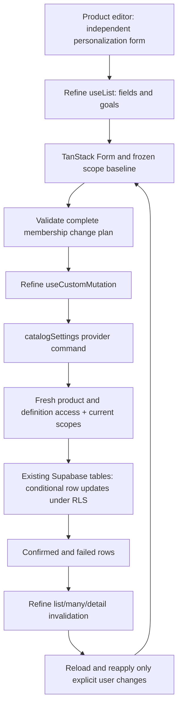

# Product editor and personalization choices

## Editor layout

`ProductFormContent` keeps one main product form with a sticky Save footer.
`ProductFormFields` groups the existing inputs into cards for product basics,
story content, and pricing/writing styles. A responsive side rail holds the
cover upload/media picker, age range and edit-only active state. Mobile stacks
the same sections in one column. Custom products expose electronic pricing and
writing styles; the latter uses `ToggleGroup` inside `BaseFormField`, retaining
the shared validation and accessible field metadata.

Main create/update still uses the existing resource-owned submission flow:
validate, resolve pending cover uploads, save through Refine, refresh, advance
the TanStack Form baseline and redirect after creation. New products remain
inactive. Preparation days stays a separately guarded form in its own card.

The product edit page has a standalone **ProductPersonalizationSection** after
the main product form. It owns a separate dirty guard and save action. On a new
product it explains that these choices become available after the first save.

## Storage and selection rules

The existing `customization_fields` and `story_goals` tables store scope in
`applies_to`. A `null` value is global inheritance and is displayed in a
separate read-only section with its active state and a link to catalog settings.
An array is a restricted scope; it may contain product IDs and the reserved
`box` target. The editor only adds or removes the current product ID, preserving
every other target. An empty array is invalid. Removing the last target is
blocked with directions to change the definition in catalog settings. The
existing schema permits at most 100 scope targets.

Inactive definitions remain selectable and selected. Their labels explain that
the choice is stored but hidden from customers while inactive. Definitions are
read through Refine's `catalogSettings` provider, sorted by `sort_order` then
`id`. Each query requests up to 100 definitions, above the existing creation
limits of 15 fields and 30 goals. The total must match the loaded count;
incomplete responses display an error and block saving.

## Save and recovery

`personalization-scope.ts` is the pure scope planner. It emits only changed
restricted definitions and records both the expected timestamp and exact prior
scope. TanStack Form owns values, validation, dirty and submitting state;
`useResourceFormBaseline` and `ResourceFormDirtyGuard` supply the existing reset
and navigation protection. The section does not call Supabase directly. The `catalogSettings`
adapter delegates the named save command to its provider binding. That binding
rechecks fresh product edit authorization and platform product eligibility,
rechecks authorization for each definition, reads latest scopes, validates the
entire plan before writing, then uses conditional updates by `id`, `updated_at`
and the expected target set. The provider combines array `contains` and
`containedBy` filters so target order does not matter. Every scope update advances `updated_at` and requires a
returned row to count as confirmed.

There is no backend transaction for multiple existing rows. A failed or
unconfirmed row is reported as partial completion; the UI keeps the requested
selection and invalidates catalog settings list/many/detail queries. After a
confirmed partial response it reloads actual scopes and reconciles automatically;
failed/stale reads require an explicit refresh before retry. Reconciliation changes the baseline
to actual server scopes and reapplies only the user's explicit membership
changes, preserving unrelated external additions. A retry plans only remaining
changes; removed or newly global definitions are called out. Stale scopes fail
before writes and offer the same explicit refresh/review flow. Writes do not
clone, delete, deactivate, or change global
definitions. No schema, policy, migration, function, or deployment is added.

Initial loading, read failure/retry, empty definitions and denied access are
visible. A background read failure keeps an initialized editor mounted with its
dirty choices and navigation guard, but blocks further saving. Reconciliation
also blocks controls while it reloads. Saving main product changes must finish
before editing scope membership. Failure after a confirmed mutation is reported
as saved changes with an incomplete refresh, rather than replaying writes.

## Module responsibilities

- `form-page/form.tsx`: `useProductFeatureForm` retains main values/upload/save
  mapping; `ProductFormContent` composes the three independent forms;
  `ProductFormFields` owns the responsive cards; `PreparationDaysSection`
  retains its existing fresh-record save path.

- `form-page/personalization-section.tsx`: Refine definition reads, access and
  loading states, inherited display, selections, save feedback, invalidation,
  reconciliation, and independent dirty navigation protection.
- `form-page/personalization-scope.ts`: scope planning and invariants, with no
  UI or database dependency.
- `data-provider/catalog-settings-adapter.ts`: named provider extension point;
  remains pure and delegates custom commands.
- `data-provider/product-personalization-command.ts`: pure fresh-product and
  definition validation, complete plan-before-write checks, conditional scope
  executor, and confirmed/partial results.
- `data-provider/catalog-settings-data-provider.ts`: binds the command to the
  current Supabase client and fresh Refine access checks.
- `tests/product-personalization-scope.test.mjs`: scope preservation, inherited
  behavior, last-target protection, stale token propagation, and partial retry
  planning.
- `tests/product-personalization-command.test.mjs`: execution against controlled
  row stores, fresh product/setting authorization, timezone-offset timestamps,
  whole-plan rejection, compare-and-swap conflicts, unconfirmed writes and
  remaining-only retries after partial failure.

## Verification

All 64 tests pass, including the existing upload and form-baseline regression
checks. TypeScript and the production build pass, with existing route-generator
and bundle-size warnings. The authenticated localhost create view was inspected visually;
switching to custom exposed electronic pricing and writing styles, and an
empty submit showed Arabic validation without creating a record. Final build
and review outcomes are recorded in `context/progress-tracker.md`. No live
product/settings changes were used for verification.
