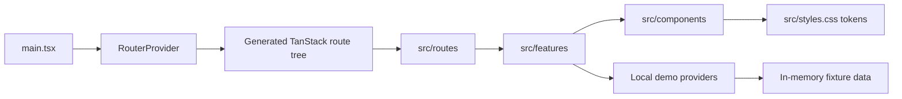

# Admin architecture

## Status

This is the architecture of the current frontend preview. The app is a browser
SPA; it does not currently connect to the production database or authenticate
real administrators.

## Runtime and request flow

- `src/main.tsx` imports global styles and wraps the router with shared
  providers such as tooltips.
- `src/router.tsx` configures TanStack Router, including link-intent preloading
  and default pending timing.
- `src/routes/` contains file-based route modules. They own URL parsing,
  redirects, page metadata, and route-level loading/error states, then compose
  feature pages.
- `src/routeTree.gen.ts` is generated by the TanStack Router plugin from route
  files. Add or rename routes in `src/routes/`, then let the generator update
  the tree.
- `src/features/` contains page and workflow implementations. Current areas
  are the component showcase, forms/form prototype, and calendar.
- `src/components/ui/` contains shared shadcn-style primitives. The
  `src/components/refine-ui/` modules compose those primitives with Refine
  patterns such as data tables, forms, notifications, and layout.

## Current data and authentication

`src/features/component-showcase/demo-provider.tsx` supplies Refine with local
product fixtures and a preview identity. `src/features/form-prototype/` has a
separate in-memory provider that simulates latency and failures for form demos.
Neither provider sends requests to a server. Their mutable data lives only in
the browser process and resets on reload.

The preview auth provider always succeeds. It is for rendering the UI only; it
does not protect routes or authorize operations. Production permissions and
business rules must be enforced by a trusted server.

## Feature and dependency rules

- Keep route modules focused on URL concerns and composition. Put feature UI,
  feature state, and feature-specific types in `src/features/<feature>/`.
- Keep reusable visual primitives in `src/components/ui/`; keep shared admin
  compositions in `src/components/` or `src/components/refine-ui/` when they
  are used by more than one feature.
- Keep `src/lib/` for generic utilities. Do not put unrelated feature
  operations into a single global data module.
- Keep generated output, such as `src/routeTree.gen.ts`, out of manual edits.
- Model loading, empty, error, and success states in the feature that owns the
  page. Route-level errors belong in the route or its shared route-state module.

## Production integration seam

There is no production data adapter in this app yet. Before connecting a real
feature, define a small typed interface for its read/write operations and keep
the UI independent of the transport. Put the concrete adapter behind that
interface and handle authorization and state transitions on the trusted
server. Keep secrets and database credentials out of the Vite bundle.

Because `admin/` is a separate Vite app from `client/`, do not import
Next.js-only server actions directly into this frontend. Connect through a
protected server endpoint/BFF, or host the admin UI in the same server runtime
if direct server-action calls are required. That integration choice has not
been implemented yet.
